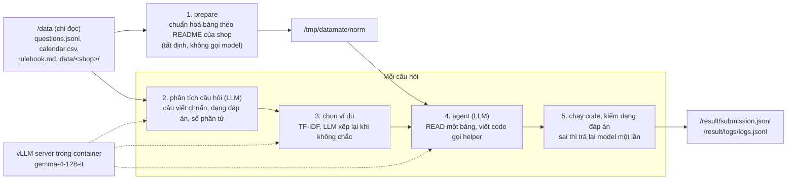
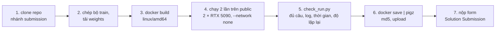

# DataMate agent

Trả lời câu hỏi tiếng Việt về dữ liệu bán hàng của từng shop. Dữ liệu được chuẩn hoá tất định, LLM viết một dòng
code gọi các helper đã đóng gói, code chạy trong container và kết quả là đáp án.



## Cách làm

1. **Đọc dữ liệu.** `datamate_agent.prepare` đọc mọi file `xlsx`, `csv`, `sqlite` của shop, nhận vai trò cột từ mô tả trong
   `README.md` của shop và tên cột, rồi ghi bảng chuẩn (`sales`, `orders`, `purchases`, `catalog`…) vào thư mục tạm. Bước này
   tất định, không gọi model.
2. **Phân tích câu hỏi.** LLM viết lại câu cho chuẩn chính tả và cho biết dạng đáp án, số phần tử. Code kiểm số, kỳ, tên
   riêng, đơn vị của câu viết lại; sai thì bỏ câu viết lại và dùng câu gốc.
3. **Chọn ví dụ.** TF-IDF tìm 8 câu train đã giải đúng gần nhất (thư viện ví dụ, mục Dữ liệu); khi hai ví dụ đầu sát điểm
   nhau, LLM chọn lại. 4 ví dụ đưa vào prompt.
4. **Sinh và chạy code.** Agent đọc một bảng rồi viết code gọi helper của `datamate.shop` (ví dụ
   `revenue(clock.month(5, 2026), group='bia')`). Helper cài sẵn luật của rulebook. Code chạy trong subprocess riêng,
   chỉ đọc bảng đã chuẩn hoá.
5. **Chọn đáp án.** Dòng in cuối của code là đáp án. Đáp án sai dạng so với bước 2 thì trả lại model một lần. Kỳ hỏi nằm
   ngoài dữ liệu hoặc shop không ghi thông tin cần thì trả `unanswerable`. Đáp án sai định dạng thì ghi `abstain`.

Mỗi câu xong được ghi ngay vào `/result/submission.jsonl` và `/result/logs/logs.jsonl`.

## Model

| Tên | Nguồn | Revision cố định | Ngày phát hành gốc | Giấy phép | Số tham số |
|---|---|---|---|---|---|
| `google/gemma-4-12B-it` | https://huggingface.co/google/gemma-4-12B-it | `707f0a3b8a3c7ad586ed01e27eafbad8a27dd0f7` (2026-07-20) | 2026-05-23 | Apache-2.0 | 11.959.730.224 |

Đây là model duy nhất khi chạy: phân tích câu hỏi, xếp lại ví dụ và viết code. Không dùng embedding, reranker hay
classifier; chọn ví dụ bằng TF-IDF, không có tham số học. Tổng số tham số khi chạy: 11,96B. Không fine-tune. Weights
nằm trong image ở `/code/models/gemma-4-12B-it`, phục vụ bằng vLLM với `--tensor-parallel-size 2`.

## Dữ liệu

| Dữ liệu | Nguồn | Cách tạo | Số mẫu |
|---|---|---|---|
| Train | Bộ train của ban tổ chức (`training_code/data/train`) | Chia sẵn trong `split/`: 2550 câu `train_*`, 450 câu `test_*` để đo | 3000 câu |
| Thư viện ví dụ `src/datamate_agent/prompts/library.jsonl` | Câu `train_*` | `datamate_agent.oracle` sinh code theo mẫu câu, chạy trên bảng chuẩn hoá, giữ cặp khớp gold (1109); thêm code agent đã khớp gold trên câu train (98, kèm log prompt và response gốc) | 1207 ví dụ |
| `src/datamate_agent/prompts/library_curated.jsonl` | Viết tay | Ví dụ cho các helper theo ngành | 109 ví dụ |
| Few-shot của bước phân tích câu hỏi | Câu train và câu tự viết | Viết tay, nằm trong `question_rewrite.py` | 4 ví dụ |

Không huấn luyện trên tập public hay private test và không thu thập đáp án test. Cách dựng lại thư viện ví dụ, manifest
SHA-256 và log nằm trong `training_code/` (xem `training_code/README.md`).

## Bố cục trong image

```
/code/
├── predict.sh            # điểm vào: /data → /result/submission.jsonl, /result/logs/
├── README.md
├── requirements.txt      # thư viện của pipeline, cài vào /code/deps, tách khỏi môi trường của vLLM
├── deps/                 # thư viện đã cài
├── src/                  # code inference: datamate (helper), datamate_agent (pipeline, agent)
├── models/gemma-4-12B-it/
└── training_code/        # dựng lại thư viện ví dụ, dữ liệu train, manifest
```

## Chạy

```bash
bash /code/predict.sh
```

`predict.sh` không nhận tham số. Nó bật vLLM ở `127.0.0.1:8000` với cấu hình cố định, chờ server sẵn sàng rồi chạy
`python -m datamate_agent.pipeline`. Cấu hình cố định:

| Thiết lập | Giá trị |
|---|---|
| Model | `/code/models/gemma-4-12B-it`, tên phục vụ `gemma-12b` |
| Giải mã | `temperature=0`, `seed=20261103` |
| vLLM | `--tensor-parallel-size 2 --max-model-len 32768 --gpu-memory-utilization 0.85 --enable-prefix-caching` |
| Số câu chạy song song | 8 |
| Prompt | `v10` |

Log mỗi câu (`/result/logs/logs.jsonl`, một dòng một câu): `id`, `answer`, `elapsed_ms` (từ lúc câu bắt đầu, gồm phân
tích câu hỏi, các lần gọi model và chạy code), `thinking` (nguyên văn mọi câu trả lời của model cho câu đó, theo thứ tự
gọi; model không có kênh reasoning riêng), `code` (code đã chạy ra đáp án, gọi helper trong `src/datamate`), `output`
(dòng in cuối của code). Trace đầy đủ từng câu ở `/result/logs/trace/<id>.log`, log của vLLM ở
`/result/logs/vllm_server.log`.

## Build và kiểm tra

```bash
bash training_code/download_model.sh          # weights đúng revision vào models/
bash training_code/stage_data.sh              # chép train vào training_code/data, ghi data_manifest.json
docker build --platform linux/amd64 -t zaic2026_datamate_<team_name>:final .
docker run --rm --gpus '"device=0,1"' --network none --shm-size=16g --entrypoint bash \
  -v /path/to/public_test:/data:ro -v /path/to/output:/result \
  zaic2026_datamate_<team_name>:final /code/predict.sh
```

Base image mặc định là `vllm/vllm-openai:v0.32.0`, truyền qua `--build-arg VLLM_IMAGE=...`. Gemma 4 cần vLLM từ v0.19.0,
nên không dùng `v0.10.1.1`.

Kiểm một lần chạy (đủ câu, định dạng, log, ước lượng 500 câu, độ lặp lại giữa hai lần chạy):

```bash
PYTHONPATH=src python -m datamate_agent.check_run --data /path/to/public_test --result /path/to/output \
  --other /path/to/output_run2 --wall-seconds <tổng giây> --load-seconds <giây nạp model>
```

Trên tập train có `answers.jsonl`, thêm `--gold <train>/answers.jsonl` để tính PA và chênh lệch PA giữa hai lần chạy
(ngưỡng 0,03).

Xuất image để nộp:

```bash
set -o pipefail
docker save zaic2026_datamate_<team_name>:final | pigz -p 8 > zaic2026_datamate_<team_name>.tar.gz
pigz -dc zaic2026_datamate_<team_name>.tar.gz | wc -c
md5sum zaic2026_datamate_<team_name>.tar.gz > zaic2026_datamate_<team_name>.tar.gz.md5
```

## Hướng dẫn build và nộp (cho người tiếp quản)



Hạn nộp solution: **23:59 (GMT+7) ngày 16/11/2026**. Image đã nộp không sửa được nữa. Mọi lệnh chạy từ thư mục gốc repo,
trên máy linux/amd64 có Docker, NVIDIA Container Toolkit và driver R570 trở lên.

**Bước 1. Lấy code**

```bash
git clone git@github.com:hoaileba/Datalife-zalo.git && cd Datalife-zalo
git checkout submission
```

**Bước 2. Chép dữ liệu train và tải weights.** Bộ train của ban tổ chức (thư mục có `questions.jsonl`, `answers.jsonl`,
`calendar.csv`, `rulebook.md`, `data/`, `split/`) không nằm trong git; xin anh Hoài thư mục `train/` rồi:

```bash
pip install -U "huggingface_hub[cli]"
bash training_code/download_model.sh          # ~24 GB vào models/gemma-4-12B-it, tự kiểm SHA-256 của weights
bash training_code/stage_data.sh <đường dẫn tới train>   # chép train vào training_code/data/train, ghi data_manifest.json
```

Kiểm: `ls models/gemma-4-12B-it` có `model.safetensors`, `tokenizer.json`, `config.json`; `training_code/data_manifest.json`
có dòng `models/gemma-4-12B-it/model.safetensors`.

**Bước 3. Build image.** Thay `<team_name>` bằng tên đội viết thường.

```bash
docker build --platform linux/amd64 -t zaic2026_datamate_<team_name>:final .
docker image inspect -f '{{.Os}}/{{.Architecture}} {{.Size}}' zaic2026_datamate_<team_name>:final
docker run --rm --network none --entrypoint "" zaic2026_datamate_<team_name>:final find /code -maxdepth 2
```

Base image mặc định `vllm/vllm-openai:v0.32.0`. **Không dùng `v0.10.1.1`** mà guideline gợi ý: bản đó không có Gemma 4.
Nếu vLLM v0.32 lỗi khi nạp model ở bước 4, build lại với bản vLLM khác đã chạy được gemma-4-12B-it trên RTX 5090:
`docker build --build-arg VLLM_IMAGE=vllm/vllm-openai:<tag> ...`.

**Bước 4. Chạy thử trên public, hai lần**, đúng lệnh chấm của ban tổ chức:

```bash
for run in 1 2; do
  mkdir -p out_run$run
  /usr/bin/time -v docker run --rm --gpus '"device=0,1"' --network none --shm-size=16g --entrypoint bash \
    -v /path/to/public_test:/data:ro -v $PWD/out_run$run:/result \
    zaic2026_datamate_<team_name>:final /code/predict.sh 2>&1 | tee out_run$run.console.log
done
```

`predict.sh` in `load_model_ms` khi vLLM sẵn sàng và `total_ms` khi xong. Nếu lỗi, xem
`out_run1/logs/vllm_server.log`. Lỗi hay gặp theo guideline:

| Triệu chứng | Cách sửa |
|---|---|
| Treo khi khởi tạo hai GPU (NCCL) | Thêm vào Dockerfile `RUN pip install --no-cache-dir --no-deps nvidia-nccl-cu12==2.27.7` rồi build lại |
| `No space left on device` ở `/dev/shm` | Thiếu `--shm-size=16g` trong lệnh chạy |
| Hết bộ nhớ GPU khi nạp | Giảm `MAX_MODEL_LEN` (32768) hoặc `GPU_MEMORY_UTILIZATION` (0.85) trong `predict.sh`, build lại |
| Không có `/health` sau 30 phút | Xem `vllm_server.log`; thường do bản vLLM không hỗ trợ model, đổi `VLLM_IMAGE` |

**Bước 5. Kiểm kết quả.** Chạy ngoài container, cần Python có `pandas`, `pydantic`:

```bash
PYTHONPATH=src python3 -m datamate_agent.check_run --data /path/to/public_test --result out_run1 \
  --other out_run2 --wall-seconds <total_ms/1000 của lần 1> --load-seconds <load_model_ms/1000 của lần 1>
```

Đạt khi in `OK`, dòng ước lượng 500 câu báo **trong** giới hạn 6 giờ. Hai lần chạy nên giống nhau gần hết; nếu chênh
nhiều, chạy thêm trên tập train có đáp án (`--gold <train>/answers.jsonl`) để chắc PA lệch không quá 0,03.
Gửi anh Hoài `out_run1/submission.jsonl` để so điểm với bản đã nộp public trước khi xuất image.

**Bước 6. Xuất image**

```bash
set -o pipefail
docker save zaic2026_datamate_<team_name>:final | pigz -p 8 > zaic2026_datamate_<team_name>.tar.gz
pigz -dc zaic2026_datamate_<team_name>.tar.gz | wc -c        # dung lượng .tar, phải ≤ 100 GB
md5sum zaic2026_datamate_<team_name>.tar.gz > zaic2026_datamate_<team_name>.tar.gz.md5
```

Upload `.tar.gz` lên Google Drive, để quyền "anyone with the link". Tải lại từ link trên một máy khác và chạy
`md5sum -c zaic2026_datamate_<team_name>.tar.gz.md5` phải ra `OK`. Không đổi tên file sau khi tạo `.md5`.

**Bước 7. Nộp** qua form "Solution Submission" trên portal Zalo AI Challenge: link Google Drive, nội dung file `.md5`,
dung lượng `.tar` (số byte ở bước 6). Mỗi đội được nộp 2 lần, ban tổ chức chấm lần cuối.

## Chạy khi phát triển

Có thể chạy pipeline với một server OpenAI-compatible bên ngoài. `--backend` chọn một backend cho cả lần chạy, không tự
chuyển:

```bash
PYTHONPATH=src python -m datamate_agent.pipeline --backend vllm \
  --dataset <thư mục test> --work <thư mục ghi được> --out <file nộp>
```

| Biến | Ý nghĩa |
|---|---|
| `VLLM_BASE_URL`, `VLLM_API_KEY`, `VLLM_MODEL` | Server vLLM |
| `OPENROUTER_BASE_URL`, `OPENROUTER_API_KEY`, `OPENROUTER_MODEL` | Chỉ để thử khi phát triển; bản nộp không gọi dịch vụ ngoài |
| `DATAMATE_EXTERNAL_LLM=1` | `predict.sh` không bật vLLM trong container mà dùng `VLLM_*` đã đặt |

`--question-mode normalize` là chế độ thử nghiệm: LLM đề xuất thay thế cục bộ thay cho viết lại cả câu, code kiểm vị trí
sửa, tên, chữ số, kỳ, đơn vị trước khi nhận. Bản nộp dùng `rewrite`.

## Đáp ứng yêu cầu kỹ thuật

| Yêu cầu | Cách đáp ứng |
|---|---|
| Model ≤ 15B, phát hành trước 26/10/2026, giấy phép cho phép | Một model 11,96B, revision 2026-07-20, Apache-2.0 |
| Không dùng dịch vụ ngoài | vLLM chạy trong container, weights trong image, `HF_HUB_OFFLINE=1`, `TRANSFORMERS_OFFLINE=1` |
| Không can thiệp tay, không logic theo mã câu hỏi hay shop | Không có mã shop hay mã câu hỏi trong code. Cờ `--holdout` của agent (chỉ để đo trên train) không dùng trong pipeline |
| `/data` chỉ đọc | Mọi file tạm ghi vào `/tmp/datamate`; đã thử với thư mục data không có quyền ghi |
| Ghi đáp án ngay | Mỗi câu xong ghi một dòng vào `submission.jsonl`; cuối lần chạy ghi lại theo thứ tự câu hỏi |
