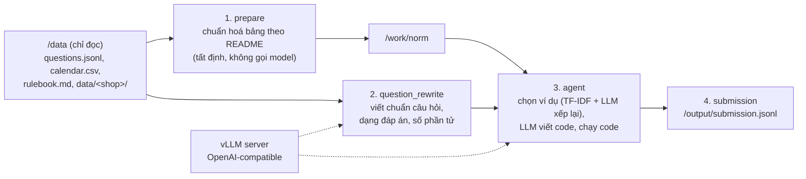

# DataMate agent

Trả lời câu hỏi tiếng Việt về dữ liệu bán hàng của từng shop. Agent đọc bảng đã chuẩn hoá, sinh code Python gọi
các helper của `datamate.shop`, chạy code trong container rồi trả đáp án.



## Model dùng khi chạy

| Model | Số tham số | Vai trò |
|---|---|---|
| `google/gemma-4-12B-it` | 12B | LLM duy nhất: phân tích câu hỏi, xếp lại ví dụ, viết code |

Không dùng embedding, reranker hay classifier nào khác. Chọn ví dụ bằng TF-IDF, không có tham số học.
Tổng số tham số khi chạy: 12B.

## Dữ liệu dùng để dựng hệ thống

- Thư viện ví dụ `src/datamate_agent/prompts/library.jsonl`: chỉ câu hỏi và code đã khớp gold của tập train.
- `src/datamate_agent/prompts/library_curated.jsonl`: ví dụ viết tay cho các helper theo ngành.
- Few-shot của bước phân tích câu hỏi: câu train và câu tự viết.

## Chạy

Build image:

```bash
docker build -t datamate-agent .
```

Chạy trên một tập câu hỏi (dữ liệu mount chỉ đọc, file nộp ghi ra `/output`):

```bash
docker run --rm \
  -v <thư mục test>:/data:ro \
  -v <thư mục output>:/output \
  -e VLLM_BASE_URL=<địa chỉ server vLLM, ví dụ http://localhost:8000/v1> \
  -e VLLM_API_KEY=<api key của server> \
  -e VLLM_MODEL=<tên model trên server> \
  datamate-agent
```

Chạy ngoài Docker:

```bash
PYTHONPATH=src python -m datamate_agent.pipeline --backend vllm \
  --dataset <thư mục test> --work <thư mục ghi được> --out <file nộp>
```

## Cấu hình

| Biến | Ý nghĩa |
|---|---|
| `LLM_BACKEND` | `vllm` (mặc định trong image) hoặc `openrouter`. Mỗi lần chạy dùng đúng một backend, không tự chuyển |
| `VLLM_BASE_URL`, `VLLM_API_KEY`, `VLLM_MODEL` | Server vLLM OpenAI-compatible |
| `OPENROUTER_BASE_URL`, `OPENROUTER_API_KEY`, `OPENROUTER_MODEL` | Chỉ để thử nghiệm khi phát triển; bản nộp không gọi dịch vụ ngoài |
| `DATAMATE_NORM_ROOT` | Thư mục bảng chuẩn hoá; pipeline tự đặt thành `<work>/norm` |

## Đáp ứng yêu cầu kỹ thuật

| Yêu cầu | Cách đáp ứng |
|---|---|
| Model ≤ 15B, công bố trước 26/10/2026 | Một model 12B, khai ở bảng trên |
| Không dùng dịch vụ ngoài | Mọi bước trừ LLM chạy offline (đã thử với `--network none`); LLM gọi server vLLM chạy cùng máy |
| Không có người can thiệp, không logic theo mã câu hỏi hay shop | Không có mã shop hay mã câu hỏi trong code. Cờ `--holdout` (chỉ dùng khi đo trên train) mặc định tắt |
| Thư mục data chỉ đọc | Mọi file tạm ghi vào `--work`; đã thử với thư mục data không có quyền ghi |
