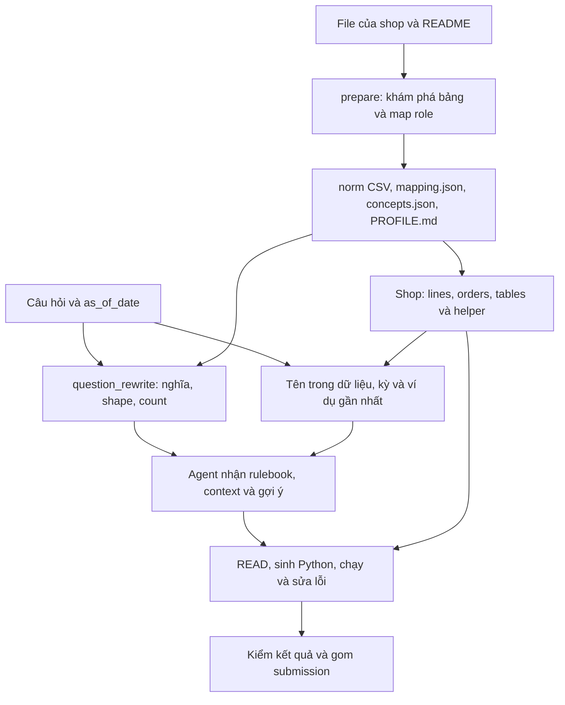

# DataMate: ưu nhược điểm, overfit và khả năng tích hợp biz mới

Ngày review: 09/11/2026. Source: nhánh `gemma4-vllm-submission`, commit `9d1e98b0edc6b44f69cd23571d6f969fdecd0187`.

Trạng thái: tài liệu review, chưa phải quyết định thay đổi kiến trúc. Không sửa source, không gọi model, không mở hoặc chạy thực nghiệm mới. Các ví dụ về private và biz mới dưới đây là tình huống giả định, không phải lỗi đã được đo trên private.

Đọc nhanh: mục 4 phân loại khả năng nhận biz mới; mục 5 chỉ các giới hạn trong source; mục 7 đánh giá bằng chứng overfit; mục 8–9 là khuyến nghị và cách kiểm chứng.

Bổ sung sau khi đọc lỗi thực tế: [09 — Phương án tiếp cận và lỗi Gemma-4](09-phuong-an-tiep-can-va-phan-tich-loi.md). Bản này xác nhận các lỗi rewrite, mẫu curated, kiểm điều kiện và deadline từ log; không coi mọi lỗi hiện tại đều bắt nguồn từ schema mới.

## 1. Kết luận và phạm vi bằng chứng

**Hệ thống có khả năng tiếp nhận nhiều shop mới nếu dữ liệu và nghiệp vụ vẫn nằm trong các quy ước đã hỗ trợ. Hệ thống chưa đủ dynamic để tự tích hợp nhiều loại biz mới có schema, quan hệ bảng hoặc nghiệp vụ chưa biết.**

Trong tài liệu này, **dynamic** là khả năng nhận đầu vào mới và chọn cách xử lý đúng khi chạy, không phải sửa source cho từng shop. **Schema** là cấu trúc bảng, cột và quan hệ giữa bảng. **Overfit** là việc giải pháp bám các đặc điểm của dữ liệu và câu hỏi đã dùng để phát triển, khiến kết quả suy giảm khi những đặc điểm đó thay đổi.

Các tên cần để đối chiếu source:

| Tên | Nghĩa trong hệ thống này |
| --- | --- |
| `role` | Vai trò chuẩn của cột, ví dụ `line_amount` là tiền một dòng hàng |
| `concept` | Ý nghĩa nghiệp vụ mà helper ngành nhận biết, ví dụ `delivery_date` là ngày giao |
| `helper` | Hàm Python tính sẵn một phép tính nghiệp vụ, ví dụ `revenue` |
| `capability` | Một khả năng tính toán mà dữ liệu và code có thể đáp ứng |
| `view`, `donor` | View là bảng nhìn theo nhu cầu tính toán; donor là bảng cho thông tin để bổ sung vào bảng khác |
| `mixin` | Lớp ghép thêm một nhóm phương thức vào `Shop`, như nhóm nhà thuốc |
| internal contract | Hợp đồng nội bộ giữa các tầng về cấu trúc và ý nghĩa dữ liệu được truyền |
| `few-shot`, TF-IDF | Few-shot là ví dụ trong prompt; TF-IDF là cách cho trọng số từ theo độ phổ biến trong thư viện để tìm ví dụ |
| `shape`, `count`, `needs` | Dạng đáp án, số phần tử và thông tin câu hỏi cần, do bước rewrite trả về |
| snapshot, fixture | Snapshot là bản chụp source cố định của lần đo; fixture là bộ đầu vào kiểm tra được chuẩn bị trước |

Ba kết luận cần phân biệt:

1. **Tái sử dụng được:** một `revenue` có thể dùng cho nhiều shop đã map đúng vào cùng ý nghĩa dòng bán. Không cần một script cho mỗi `business_id`.
2. **Có điểm để mở rộng:** đã có giao diện mapper, bảng concept và module theo ngành. Có thể phát triển tiếp bằng code; chưa đồng nghĩa tự thích nghi khi chạy.
3. **Chưa được chứng minh tổng quát:** điểm public và lần đo loại ví dụ cùng shop chưa đủ kiểm chứng việc tiếp nhận schema hoặc nghiệp vụ chưa tham gia thiết kế.

**Khuyến nghị:** giữ Semantic Layer (lớp số đo nghiệp vụ dùng chung), nhưng coi khả năng tiếp nhận dữ liệu mới là hạng mục cần kiểm chứng riêng. Chưa nên khẳng định giải pháp hiện tại là engine tổng quát cho mọi biz. Lý do cụ thể: pipeline chọn mapper tất định; bộ concept và bộ ngành là danh sách tĩnh; helper có giả định về chọn bảng và join chưa biểu diễn thành hợp đồng dữ liệu rõ ràng. [E02], [E03], [E04], [E06]

Quy ước bằng chứng:

- **Code:** hành vi đọc trực tiếp từ source tại commit trên; chưa có nghĩa đã tái hiện lỗi bằng chạy thử.
- **Kết quả cũ:** số lấy từ thực nghiệm đã lưu; ghi rõ model, tập và nguồn tham chiếu.
- **Giả thuyết:** dự đoán khi đổi đầu vào hoặc đề xuất hướng thử; chưa phải cải tiến đã đo.

Repo có `AGENT.md` và `FAILURES.md`. Không thấy `CONTEXT.md`, `docs/01-phan-tich-du-lieu.md`, `docs/02-plan-kien-truc.md` trong checkout hiện tại. `docs/06` và `docs/07` là tài liệu ở thời điểm trước; tài liệu này dựa vào source để mô tả hành vi hiện tại, không coi khoảng cách giữa docs và code là lỗi. Local không có `origin/develop`; nhánh remote tương ứng hiện tại là `origin/gemma4-vllm-submission`.

## 2. Bài toán và luồng xử lý thực tế

DataMate yêu cầu trả lời câu hỏi tiếng Việt trên dữ liệu của từng shop theo `rulebook.md`. Ngày tham chiếu lấy từ `as_of_date`. Đáp án phải đúng cả phép tính, giá trị, thứ tự và type; đúng +1, sai −1, bỏ trống 0. `unanswerable` là đáp án được chấm đúng/sai, không phải bỏ trống. [E01]

Các ranh giới đáng chú ý:

1. `pipeline.main` gọi `prepare` mà không truyền model mapping; `prepare` mặc định `--model readme`. Việc chọn model suy luận cho pipeline không chuyển mapper sang LLM. [E02], [E03]
2. `Shop` dựng một bảng `lines` chính cho nhiều helper, còn `tables` giữ các bảng đã đọc. Agent được phép viết pandas khi helper không khớp; nó không bị giới hạn tuyệt đối vào một dòng gọi helper. [E06], [E10]
3. Rulebook được đọc từ dataset và đưa vào prompt. Luật bên trong helper vẫn là Python đã viết trước, không được biên dịch lại từ rulebook mới. [E10], [E17]
4. `oracle.py` là bộ giải bằng mẫu câu để xây ví dụ và đối chiếu với gold; `pipeline.main` không gọi oracle khi trả lời. Thư viện ví dụ được nạp từ file đã có. [E02], [E09], [E16]

## 3. Kiểm kê thành phần và ownership

**Ownership** là nơi chịu trách nhiệm định nghĩa và thay đổi một khái niệm. Bảng giữ đúng bốn cột; tên thành phần nằm trong cột đầu.

| Mang thông tin gì | Tồn tại để làm gì | Ai đang dùng | Đánh giá |
| --- | --- | --- | --- |
| **Input:** file/sheet/bảng SQLite, README, rulebook, calendar, câu hỏi | Cung cấp dữ liệu và quy ước của dataset | `prepare`, `build_system`, `Clock`, pipeline | Hợp đồng dữ liệu đầu vào; reader chỉ nhận định dạng đã hỗ trợ. README đang là phụ thuộc bắt buộc của prepare. |
| **Discovery và header group:** nguồn, dòng header, tuple cột, mẫu dòng | Phát hiện bảng và dùng chung mapping cho nguồn cùng header | `normalize_shop`, mapper | Internal contract của normalization; tự khám phá file nhưng gộp theo hình thức header, chưa theo ý nghĩa bảng. [E04] |
| **Role và kiểu:** cấp order/line/record, ngày, tiền, số, ID | Định nghĩa ý nghĩa chuẩn để helper dùng chung | mapper, `check_roles`, `_typed`, `Shop` | Domain thật ở các khái niệm như tiền dòng/tiền đơn; schema Python cụ thể là internal contract. [E24] |
| **ReadmeMapper:** danh sách mô tả, tên cột, luật ngữ cảnh và status | Đổi cách ghi của nguồn về role đã biết | `prepare_shop`, `_map_group` | Owner là tầng tích hợp nguồn. Đang trộn từ vựng nguồn với suy luận nghiệp vụ; không phải kiến thức cho mọi biz. [E03], [E05] |
| **ColumnMapper và mapping cache:** phương án LLM hoặc mapping lưu sẵn | Cho phép thay chiến lược map và chạy lại | `prepare --model/--mappings`, `normalize_shop` | Điểm mở rộng hiện có. Không được pipeline mặc định tự dùng khi schema lạ. [E03] |
| **Cleaning và báo cáo:** parse, dòng bị loại, role bị từ chối, nguồn dòng | Tạo bảng có kiểu và lưu bằng chứng biến đổi | `Shop`, agent, người kiểm tra qua `PROFILE.md` | Internal contract hữu ích; kiểm parse không chứng minh map đúng ngữ nghĩa. Cột chưa map vẫn được giữ lại. [E04] |
| **Join và chọn bảng:** đầu đơn/dòng hàng, `lines`, bảng nghiệp vụ đầu tiên | Tạo view để phép tính dùng được | `Shop`, helper chung và helper ngành | Owner là tầng tích hợp dữ liệu. Giả định một bảng chính, donor đầu tiên và join key cố định làm giảm tính dynamic. [E06] |
| **Concept:** `delivery_date`, `machine_id`, `lot_sold`… | Tách helper khỏi một số tên cột nguồn | `domains_of`, `Shop._book`, helper ngành | Khái niệm có ý nghĩa nghiệp vụ; từ điển nhận diện do owner tích hợp nguồn quản lý. Danh sách hiện tĩnh. [E07] |
| **Domain requirements, mixin và danh sách helper:** nhóm ngành và phương thức | Bật context theo concept và cung cấp phép tính ngành | `build_system`, thư viện ví dụ, `Shop`, preamble | Owner domain. Chọn nhóm đã biết khi chạy; thêm nhóm mới vẫn cần cập nhật code. [E08], [E10] |
| **Clock và số đo chung:** kỳ, doanh thu, đơn, số lượng, ranking, nợ, tồn | Áp công thức và rulebook nhất quán | code do LLM sinh, oracle | Domain thật; nên giữ. Tính đúng chỉ có ý nghĩa khi đầu vào và chính sách nghiệp vụ tương thích. [E17] |
| **Entity linking và question hints:** tên trong dữ liệu, alias, kỳ | Nối cách hỏi với giá trị thật và gợi ý tham số | rewrite, masking, agent | Internal contract của hiểu câu hỏi; lấy nhiều tên từ `lines`, nên có thể bỏ sót mặt hàng chưa bán chỉ có trong catalog. [E09] |
| **Thư viện ví dụ và chọn mẫu:** câu, code, intent, ngành yêu cầu, shop nguồn | Đưa mẫu phép tính cho LLM | `pick_examples`, prompt agent | Artifact phát triển từ train và ví dụ curated; hữu ích nhưng không phải định nghĩa nghiệp vụ. Không tự thêm mẫu mới khi chạy. [E09] |
| **Question rewrite:** câu viết chuẩn, shape, count, needs | Hỗ trợ hiểu câu hỏi và kiểm một phần dạng đáp án | agent, bước chọn lại ví dụ dùng rewritten | Owner là hiểu câu hỏi. `needs` được truyền vào question nhưng `analysis_hint` hiện chỉ hiển thị shape/count; chưa có cổng kiểm đủ dữ liệu theo từng need. [E10], [E11] |
| **Prompt, vòng agent, executor:** lệnh READ/run/FINAL, timeout, lỗi thực thi | Cho model khảo sát, sinh và sửa code | pipeline, model, `local_runner` | Internal contract của thực thi. Cơ chế sinh code linh hoạt hơn helper, nhưng chưa có bằng chứng độ đúng cho biz chưa hỗ trợ. [E10] |
| **Answer gate và submission:** type, shape, lỗi code, abstain | Giảm đáp án sai format và bỏ trống khi thất bại | `_final`, `_final_unanswerable`, `build_submission` | Owner là hợp đồng đáp án. Chưa kiểm được công thức đúng với câu hỏi; cổng shape cũng không phải bảo đảm cứng. [E10], [E12] |
| **LLM backend và runtime config:** model, API client, parallel, đường dẫn work | Thay nơi chạy suy luận, kiểm tài nguyên | pipeline, rewrite, agent | Config thuộc connector/runtime. Thay backend không làm thay schema hay logic nghiệp vụ. [E02], [E18] |
| **Oracle, scorer, error analysis, experiments:** code mẫu, tham chiếu, kết quả | Xây ví dụ, đo và phân tích lỗi | workflow phát triển; không nằm trong luồng trả lời chính | Tooling phát triển, không phải domain runtime. Kết quả phải gắn model, nguồn gold và phạm vi đã dùng để phát triển. [E13], [E14], [E16] |

Không kết luận thành phần là code chết chỉ vì nó không nằm trên pipeline mặc định. Ví dụ `ColumnMapper` vẫn có đường gọi qua CLI của prepare; nó là phương án phụ, không phải cơ chế thích nghi đang tự chạy.

## 4. Dynamic tới đâu khi gặp biz mới

Phân biệt **thêm một shop**, **thêm cách biểu diễn cùng nghiệp vụ**, và **thêm nghiệp vụ mới**. Cùng có `business_id` mới không có nghĩa độ khó như nhau.

| Trường hợp | Hệ thống tự làm được gì theo source | Điều kiện hoặc phần phải bổ sung | Kết luận về tính dynamic |
| --- | --- | --- | --- |
| Shop mới, tên/mã/số liệu mới; giữ quy ước nguồn và luật | Quét thư mục shop, map role quen, nạp tên và tính helper trên dữ liệu mới | Mapping, đơn vị và ý nghĩa cột phải đúng | Có cơ chế tái sử dụng trực tiếp; chưa có số private để bảo đảm chất lượng. [E03], [E09] |
| Cùng nghiệp vụ, thêm file/sheet có header giống | Gộp các nguồn cùng tuple header | Header giống phải thực sự cùng ý nghĩa; ID và phạm vi nguồn phải tương thích | Tự động trong điều kiện hẹp, không phải tự hiểu mọi bố cục file. [E04] |
| Cùng nghiệp vụ, đổi tên cột/README | Tra mô tả đã biết, tên cột đã biết, rồi luật ngữ cảnh | Từ vựng lạ có thể cần sửa mapping; pipeline chưa tự chuyển sang LLM mapper | Chưa đủ dynamic cho nguồn tuỳ ý. [E05] |
| Cùng nghiệp vụ, đổi cách chia hoặc nối bảng | Có join đầu đơn/dòng hàng và tìm bảng theo concept | Giả định donor/key/bảng đầu tiên phải còn đúng; quan hệ mới cần logic tích hợp mới | Khả năng tự thích nghi hạn chế. [E06], [E07] |
| Ngành mới nhưng vẫn bán theo đơn/dòng hàng, cùng cách tính | Helper chung có thể áp dụng mà không cần một domain ngành mới | Phải map về đúng cùng ý nghĩa. Ví dụ shop văn phòng phẩm vẫn hỏi doanh thu theo đơn | Có thể dùng phần chung; tên ngành mới tự nó không bắt buộc thêm code. [E17] |
| Nghiệp vụ mới như thuê theo giờ, số dư buổi học, gia hạn hợp đồng | Agent có thể thử viết Python trên bảng; chưa có số đo chứng minh | Nếu cần hỗ trợ ổn định thì phải định nghĩa concept, luật, phép tính, context và kiểm lại | Có điểm mở rộng bằng phát triển; chưa tự tích hợp khi chạy. [E07], [E08], [E10] |
| Biz có nhiều hoạt động đã hỗ trợ | Có thể phát hiện nhiều nhóm requirement cùng tồn tại | Chọn bảng sales và join vẫn có thể chỉ bao phủ một phần; một nhãn domain không chứng minh toàn bộ helper dùng được | Ghép capability đã biết là một phần dynamic; chưa phải hỗ trợ đầy đủ biz hỗn hợp. [E06], [E08] |
| Cùng dữ liệu nhưng rulebook đổi nghĩa số đo | Prompt nhận văn bản rulebook mới | Helper không tự đổi công thức; model phải nhận ra xung đột và tránh helper không phù hợp | Không có cơ chế bảo đảm tự thích nghi chính sách. [E10], [E17] |

**Điều kiện đủ tối thiểu để một shop mới đi qua đường helper hiện tại:** reader đọc được → mapper gán đúng role/concept → chọn và nối đủ bảng → nghiệp vụ phù hợp với công thức helper → model chọn đúng hàm/tham số → đáp án hợp format. Tự động ở bước cuối không bù được việc sai ở bước đầu.

Ví dụ cần nhớ: cửa hàng sách với `order_id`, `order_date`, `line_amount` đúng nghĩa có thể dùng `revenue`. Một trung tâm dạy học có cột tên là `Thành tiền` nhưng ghi tiền thu trước cho nhiều kỳ không đương nhiên mang cùng nghĩa. Đây là khác biệt nghiệp vụ giả định, không phải khẳng định dữ liệu hiện có bị như vậy.

## 5. Những giới hạn trực tiếp trong source

### 5.1. Mapping có điểm thay thế nhưng chưa tự xử lý trường hợp chưa biết

**Code:** `ReadmeMapper.propose` tra `DESCRIPTION_ROLES`, `HEADER_ROLES`, rồi `context_role`. README phải có dạng mục `## Cột trong ...` và dòng `- **cột**: mô tả` để parser lấy được mô tả; nếu không khớp, đường tra tên cột và ngữ cảnh vẫn còn. Prepare mặc định không dùng `ColumnMapper`, và pipeline không có nhánh tự thử lại bằng LLM khi mapping không đủ. [E02], [E03], [E05]

**Hệ quả với biz mới:** đổi format README đơn thuần chưa chắc làm hỏng, nhưng đổi cả format và tên cột ra ngoài từ vựng đã biết có thể mất role quan trọng. Ví dụ cột mới `GiaTriDongSauUuDai` có mô tả tự do tương đương tiền dòng chưa chắc được nhận.

**Giới hạn của validation (kiểm đầu vào theo điều kiện):** kiểm parse được tiền/ngày không đủ chứng minh đúng ý nghĩa tiền/ngày. `_level_problem` có kiểm cấp tiền, nhưng dùng tỉ lệ đơn nhiều dòng lặp một giá trị, vẫn là heuristic (luật suy đoán), không phải bằng chứng ngữ nghĩa tuyệt đối. [E04]

### 5.2. Quan hệ bảng vẫn được suy từ những giả định cố định

**Code:** `group_heads` gộp theo tuple tên cột. `_pick_lines` ưu tiên một bảng sales có item rồi số dòng lớn nhất. `join_order_fields` lấy `donors[0]`, join theo `order_id`, và chỉ bổ sung field chưa có ở bảng đích. `_book` trả bảng đầu tiên có đủ concept. [E04], [E06]

**Ví dụ giả định:** shop có một file bán tại quầy và một file online, khác header nhưng đều là dữ liệu bán thật. Hai file có thể được chuẩn hoá riêng; `revenue` chạy trên một `lines` đã chọn sẽ không tự cộng cả hai. Nếu có nhiều bảng đầu đơn, thứ tự bảng có thể quyết định donor dù quan hệ đúng nằm ở bảng khác.

**Phạm vi kết luận:** các bảng khác vẫn có thể nằm trong `tables`, và LLM có thể viết pandas để kết hợp. Do đó đây là giới hạn của đường helper và cách tích hợp mặc định, không phải khẳng định dữ liệu nguồn bị xoá hết hoặc không có cách tính đúng. [E10]

### 5.3. Capability mới chỉ là nhận diện nhóm đã biết, chưa là bảo đảm chạy được từng phép tính

**Capability Detection** là nhận diện tính năng có thể dùng từ thông tin hiện diện. Đây là pattern phù hợp để tránh rẽ nhánh theo mã shop, nhưng điều kiện hiện tại còn thô.

**Code:** `DOMAIN_REQUIREMENTS`, `DOMAIN_MIXINS`, `DOMAIN_HELPERS` là danh sách tĩnh. `domains_of` yêu cầu các concept của một nhóm cùng xuất hiện trong một bảng. Nhóm `pharmacy` chỉ yêu cầu `lot_sold`; trong khi `_lots_left` còn dùng `lot_received`, `lot_returned`, mã lô, hạn dùng và quan hệ về đơn. [E07], [E08], [E19]

**Ví dụ giả định:** shop được nhận là pharmacy nhưng không map được bảng nhập lô thì các hàm hạn dùng chưa chắc chạy. Ngược lại, thông tin giao hàng tách thành các bảng có quan hệ hợp lệ chưa chắc được nhận nếu điều kiện đòi concept cùng một bảng.

**Kết luận:** có nhãn domain không đồng nghĩa mọi helper domain đó khả dụng. Thêm một domain mới cũng không chỉ là thêm file prompt: phải có concept, logic phép tính và đường đăng ký vào source. Đây là mở rộng bằng phát triển, chưa phải tự nhận biết một nghiệp vụ bất kỳ.

### 5.4. Lỗi tích hợp có thể bị diễn giải thành dữ liệu không tồn tại

**Code:** `_rows` báo `shop has no sales table` khi không dựng được `lines`; `_book` báo `shop has no ...` khi không tìm thấy bộ concept đã nhận diện. Prompt hướng dẫn coi lỗi `shop has no` là thiếu thông tin, còn `_remember` đặt `helper_refused` theo chuỗi đó. [E06], [E10]

**Ví dụ giả định:** file có ngày giao hàng nhưng mapper chưa nhận ra tên mới. Helper không thấy concept và báo thiếu; model nộp `unanswerable` dù dữ liệu gốc đủ trả lời. Lỗi này có thể ảnh hưởng một loạt câu của cùng biz, không chỉ một câu.

**Phân biệt cần giữ:** dữ liệu thật sự không ghi thông tin; thông tin có nhưng hệ thống chưa map được; dữ liệu có và phép tính hợp lệ ra 0. Hiện các dấu hiệu lỗi chưa phân biệt đủ ba trạng thái đó. Việc hỗ trợ biz mới vì vậy phải kiểm cả cách nhận biết thất bại, không chỉ có chạy hết pipeline hay không.

### 5.5. Mẫu câu đã biết được ưu tiên mạnh, tham số mới chưa có cổng kiểm nghĩa

**Code:** masking thay chữ số bằng `#`. `Library.scored` chọn các intent gần nhất mà không có điều kiện tối thiểu về mức liên quan tuyệt đối. `pick_examples` gọi LLM chọn lại dựa trên khoảng cách hai điểm đầu, còn lời nhắc bảo đổi kỳ/tên và giữ tham số khác. [E09], [E10]

**Ví dụ có thật trong thư viện:** `library.jsonl:167` chứa `min_orders=140`; `library_curated.jsonl:4` chứa `rounds=2`. Với câu mới hỏi 200 đơn hoặc 3 đợt, model phải thay các tham số này. Sửa đúng kỳ và tên vẫn chưa đủ. Một truy vấn chỉ có ví dụ không liên quan cũng vẫn nhận ví dụ gần nhất.

**Giả thuyết cần đo:** lời nhắc này có thể gây lỗi sao chép ngưỡng hoặc phép so sánh khi private thay số/điều kiện. Không kết luận mọi câu thay số đều sai. Rewrite giữ chữ số của câu hỏi không đồng nghĩa code FINAL đã dùng đúng chữ số đó. [E11]

### 5.6. Rulebook mới không tự đổi nghĩa của helper

**Code:** `build_system` đưa rulebook của dataset vào prompt, trong khi `Shop`, `Clock` và helper ngành chứa công thức Python cố định. [E10], [E17], [E19]

**Ví dụ giả định:** nếu một bài mới yêu cầu doanh thu trừ chiết khấu cả đơn, việc đổi rulebook chưa tự thay `revenue`. Hệ thống có thể viết phép tính khác bằng Python, nhưng không có cổng kiểm helper nào còn phù hợp với rulebook mới.

**Đánh giá công bằng:** trong DataMate, nếu luật được giữ ổn định, đưa luật vào code là ưu điểm về độ nhất quán. Đây chỉ trở thành giới hạn khi mở sang hệ thống nhiều biz có chính sách khác nhau, hoặc private thực sự thay luật.

### 5.7. Một số giả định về giá trị đầu vào cần kiểm khi mở rộng

| Điểm cần kiểm | Hành vi trong source | Ví dụ rủi ro khi đầu vào đổi | Bằng chứng |
| --- | --- | --- | --- |
| Cận cuối dữ liệu | `_require_period` dùng `as_of`, không lấy ngày cuối dữ liệu làm cận trên | Dữ liệu dừng tháng 6, hôm nay tháng 9, hỏi tháng 8 có thể đi tới tổng rỗng bằng 0 | [E06], `Shop._require_period:316` |
| Status lạ | `ReadmeMapper.statuses` trả `None` khi không nhận; `is_revenue` chỉ loại `huỷ`/`trả hàng` | Nhãn mới mang nghĩa huỷ nhưng không được map có thể vẫn vào doanh thu | [E05], `statuses:251`; [E04], `add_derived_columns:494` |
| Đổi tiền đơn thành tiền dòng | `_promote_line_amount` dùng dung sai 1% và tỉ lệ khớp ít nhất 50% | Nguồn có nhiều đơn một dòng có thể làm heuristic nhận nhầm cấp tiền | [E04], `_promote_line_amount:599` |
| Tên nhóm và hoạt chất | `_match` thử substring nếu không có exact match trong frame đang lọc | Có thể nhận thuốc phối hợp khi hỏi riêng hoạt chất; hoặc nhận nhóm gần tên | [E06], `_match:336` |
| Tên chưa xuất hiện trong giao dịch | `entities_of` chủ yếu lấy tên từ `lines` | Hỏi tồn một hàng mới chỉ có trong catalog có thể thiếu gợi ý nối tên | [E09], `entities_of:50` |
| Tồn theo nguồn riêng | `_stock_levels` có nhánh yêu cầu cột gốc `NgayGioPhatSinh` | Nguồn tương đương nhưng tên cột khác có thể không vào đúng nhánh thẻ kho | [E06], `_stock_levels:667` |
| Kết quả rỗng hợp lệ | Submission từ chối list/table rỗng | Câu mới yêu cầu liệt kê và tập kết quả hợp lệ rỗng có thể thành abstain; phải kiểm quy định/gold trước khi đổi | [E12], `format_problem:20` |

Các con số `MIN_PARSE_RATIO=0.9`, `ALIAS_MIN_SHARE=0.2`, `LINE_AMOUNT_MIN_SHARE=0.5`, `REPEATED_IN_ORDER_SHARE=0.8` là ngưỡng của normalization, không phải xác suất model trả lời đúng. Trong bằng chứng đã đọc, chưa thấy thực nghiệm riêng chứng minh tính ổn định của các ngưỡng này khi phân bố schema thay đổi. `RERANK_MARGIN=0.05` có hồ sơ chọn trên train trong bản ghi quyết định kiến trúc số 014, nhưng cũng không phải xác suất đáp án đúng. Không có cơ sở để lấy các số đó làm ngưỡng abstain. [E03], [E04], [E10], [E20]

### 5.8. Chạy nhiều biz chưa có cách cô lập đầy đủ lỗi của một biz

**Code:** `prepare_shop` đọc README trực tiếp; `prepare.main` lấy `future.result()` không có xử lý riêng lỗi từng shop ở vòng này. Bước rewrite dựng `Shop` để lấy entity trước khối `try` của từng lần gọi model. Vì thế có lỗi đầu vào/khởi tạo có thể làm dừng cả bước trước khi agent xử lý theo từng câu. Không phải mọi lỗi normalization đều làm dừng: `_map_group` có một số lỗi được ghi lại khi `strict=False`. [E03], [E04], [E11]

**Ví dụ giả định:** thêm một shop thiếu README có thể làm prepare không hoàn tất cho cả dataset. Cần phân biệt với trường hợp đặc tả DataMate bắt buộc README: đó có thể là đầu vào ngoài hợp đồng thi, nhưng vẫn là giới hạn khi dùng làm nền tích hợp biz ngoài cuộc thi.

Về quy mô, `Shop` nạp các CSV khi khởi tạo; mỗi lần thực thi code là một process mới có preamble dựng lại `Shop`. Đây là chi phí có thật trong code, nhưng chưa đo giới hạn số shop/dung lượng nên không kết luận throughput (số câu xử lý trong một đơn vị thời gian) đủ hay thiếu. [E06], [E10]

## 6. Ưu điểm và đánh đổi kiến trúc

| Điểm mạnh | Vì sao có ích | Giá phải trả hoặc giới hạn |
| --- | --- | --- |
| Semantic Layer dùng chung | Model chọn `revenue`, `ranking` thay vì tự nhớ mọi bước lọc và cộng | Cần tự định nghĩa, kiểm và bảo trì các số đo; helper sai ảnh hưởng nhiều câu |
| Chuẩn hoá một lần trước agent | Giảm việc model lặp parse ngày/tiền và đoán cột ở từng câu | Sai mapping được lan truyền có hệ thống; phải kiểm đầu vào theo shop |
| Mapper có phương thức `propose`/`statuses` dùng chung | Là điểm áp dụng Strategy (nhiều cách thực hiện cùng một trách nhiệm); prepare có thể chọn bằng CLI | Chọn được bằng code/config chưa có nghĩa tự chọn chiến lược đúng khi gặp trường hợp mới |
| Concept tách khỏi một phần tên cột | Helper giao hàng có thể dùng `delivery_date` thay vì một tên cột của một file | Từ vựng và quan hệ dữ liệu vẫn phải được nhận đúng; một số nhánh còn đọc tên cột gốc |
| Context và ví dụ theo dữ liệu shop | Model nhận tên, bảng và mẫu ngành liên quan hơn | Khả năng nhận ngành phụ thuộc mapper; ví dụ gần nghĩa vẫn có thể khác phép tính |
| Thực thi Python và phản hồi lỗi | Có đường xử lý câu ngoài helper, kiểm kết quả thật thay vì model bịa phép cộng | Chạy được và đúng format không chứng minh đúng nghĩa; nhánh pandas cần được đo riêng |
| Lưu mapping, nguồn dòng và dòng bị loại | Có chỗ truy nguyên sai số, không chỉ xem đáp án cuối | Artifact tồn tại chưa đủ nếu luồng quyết định không dùng lỗi mapping để chọn cách xử lý phù hợp |

Không có lý do từ review này để thay toàn bộ helper bằng LLM tự làm sạch và tính. `FAILURES.md` đã ghi lỗi parse, sai mapping im lặng và vòng sửa lỗi kẹt ở các lần thử trước. Kết luận đúng là phải bảo vệ hợp đồng đầu vào của Semantic Layer, không phải bỏ phần công thức đã tái sử dụng được. [E21]

## 7. Bằng chứng hiện có về overfit

### 7.1. Kết quả cũ nói được gì

Điểm chuẩn hoá = `(đúng − sai) / tổng câu`; accuracy = `đúng / (đúng + sai)`; coverage = `(đúng + sai) / tổng câu`. Các phần trăm trong bảng dưới được tính từ số đếm đã lưu, không phải lần chạy mới.

| Lần đo đã lưu | Điểm chuẩn hoá | Accuracy | Coverage | Đúng / sai / trống | Phạm vi bằng chứng |
| --- | --- | --- | --- | --- | --- |
| Gemma-4, public 1.000 câu, chấm lenient | +0,943 | 97,77% | 98,70% | 965 / 22 / 13 | Local so với Claude; không phải gold chính thức. Chấm strict cùng file được +0,915. [E13] |
| Gemma-3, public 1.000 câu, file nộp cũ, chấm lenient | +0,878 | 94,16% | 99,40% | 936 / 58 / 6 | Cùng nguồn tham chiếu local; chấm strict được +0,850. [E13] |
| Gemma-3, train đã hoàn tất 653 câu trong lần dự kiến 1.000, chấm lenient | xấp xỉ +0,960 | 98,31% | 99,39% | 638 / 11 / 4 | Tham chiếu `train/answers.jsonl`, loại ví dụ cùng shop ở bước chọn mẫu; lần chạy dừng theo yêu cầu. [E14] |

**Không dùng khoảng +0,915 tới +0,943 làm dự báo điểm private.** Strict và lenient là hai cách chấm local với cùng tham chiếu, không phải cận thống kê của điểm chính thức. Lenient còn chấp nhận một số cách đối chiếu tên/mã dựa trên dữ liệu shop; không đồng nhất với scorer ban tổ chức. [E13]

13 câu trống ở lần Gemma-4 được báo là lỗi trả lời không dừng, vượt 180 giây. Đây là giới hạn vận hành đã quan sát trên lần chạy đó, không phải bằng chứng overfit; khi báo chất lượng vẫn phải tính chúng vào coverage. [E13]

### 7.2. Vì sao chưa có kiểm chứng độc lập cho biz mới

1. **Public đã tham gia phát triển.** Bản ghi quyết định kiến trúc số 010 mô tả việc bổ sung công thức/helper từ lỗi public và ghi ba ngành chỉ có ở public chưa kiểm độc lập. Sửa theo luật công khai là hợp lý, nhưng đánh giá lại trên chính public không còn là bằng chứng độc lập cho schema/ngành chưa thấy. [E22]
2. **Split 450 câu giữ lại câu hỏi theo type và business, không giữ lại toàn bộ business.** Đây là phép đo hữu ích cho câu mới trong miền dữ liệu quen; không thay phép đo trên nguồn mới. [E15]
3. **Loại ví dụ cùng shop chỉ giữ độc lập ở một tầng.** Trong code hiện tại, loại câu trùng và shop trùng cần cờ `--holdout`; pipeline không truyền cờ đó. Lần train 653 câu có chính sách loại ví dụ cùng shop theo hồ sơ, nhưng mapper/helper không được dựng lại trong điều kiện chưa thấy dữ liệu của shop được đo. Trên private có shop ID mới, cờ này không tự tạo khả năng hiểu schema mới. [E02], [E10], [E14]
4. **Nguồn few-shot đã được làm sạch theo hồ sơ, nhưng đó chưa đủ.** Bản ghi số 015 mô tả thay thư viện cũ có câu test bằng thư viện lấy từ `train_*`. Đây là cải thiện về train/test separation (tách dữ liệu phát triển khỏi dữ liệu đánh giá); vẫn cần kiểm độc lập phần mapper và helper. [E23]
5. **Không nên coi số cũ là số tái hiện trên commit hiện tại.** Thư mục `code/` của lần Gemma-4 public 1.000 câu hiện có `run.sh` và `score.py`; runner dùng `PYTHONPATH=src` ở repo gốc, không kèm snapshot source trong chính thư mục đó. Vì vậy review này dẫn số theo RESULT đã lưu, không khẳng định đã kiểm chứng source dùng khi đo trùng hoàn toàn commit đang review. Đây cũng là điểm chưa đáp ứng yêu cầu snapshot độc lập của `AGENT.md`. [E13]

### 7.3. Kết luận đúng mức bằng chứng

**Chưa đo được mức tụt điểm trên private, nên chưa thể kết luận hệ thống đã overfit nặng. Có bằng chứng hệ thống phụ thuộc quy ước schema và mẫu câu đã biết, đồng thời thiếu phép đo độc lập để bác bỏ rủi ro đó.**

Các dạng rủi ro nên tách riêng: bám từ vựng/tổ chức dữ liệu; bám dạng câu và tham số của ví dụ; bám phạm vi nghiệp vụ đã có helper; chọn cấu hình sau khi nhìn cùng public nhiều lần. “Không fine-tune model” hoặc “không rẽ nhánh theo mã shop” không loại bỏ các dạng phụ thuộc này.

## 8. Khuyến nghị và các phương án thay thế

**Khuyến nghị ưu tiên: giữ kiến trúc hiện tại làm nền cho nhóm nghiệp vụ đã định nghĩa; thử tăng khả năng tiếp nhận nguồn mới và chứng minh bằng đánh giá độc lập. Chưa đề xuất biến mọi luật nghiệp vụ thành config hay viết lại toàn bộ module.**

Trước khi thiết kế code tiếp, cần chốt phạm vi: hỗ trợ thêm shop theo cùng rulebook; hỗ trợ schema nguồn đa dạng; hay hỗ trợ cả định nghĩa nghiệp vụ mới. Ba mục tiêu này cần bằng chứng khác nhau.

| Phương án | Nhận xét dựa trên bằng chứng hiện có | Khuyến nghị |
| --- | --- | --- |
| Tiếp tục thêm tên cột và ví dụ để sửa từng lỗi public | Dễ thực hiện; không kiểm được việc tiếp nhận cách biểu diễn thực sự mới | Dùng cho quy ước có ý nghĩa ổn định và có bằng chứng; không lấy tăng public làm tiêu chí duy nhất |
| Giữ Semantic Layer, kiểm hợp đồng tích hợp nguồn và capability từng phép tính | Đánh đúng các giới hạn chọn bảng, join, thiếu concept và nhầm dữ liệu thiếu đã thấy trong code | **Hướng thử được ưu tiên**; chưa có số đo chứng minh bản thiết kế cụ thể tốt hơn |
| Bật LLM mapping cho mọi nguồn | Có điểm gọi sẵn, nhưng lịch sử đã có lỗi mapping im lặng | Chưa khuyến nghị mặc định; nếu thử thì đo riêng và giữ đối chứng với mapper tất định |
| Để LLM tự làm sạch và tính mọi câu | Linh hoạt về mặt biểu đạt code, nhưng những lần thử trước thất bại về dữ liệu và giao kèo | Không chọn làm hướng mặc định từ bằng chứng hiện có [E21] |
| Viết script riêng cho từng shop | Có thể xử lý shop đã biết nhưng mỗi nguồn mới lại đòi một lời giải riêng | Không đáp ứng mục tiêu tích hợp nhiều biz mới |

Các đề xuất sau là **giả thuyết thiết kế để anh duyệt**, chưa triển khai và chưa có số đo lợi ích:

1. **Adapter (lớp chuyển cách biểu diễn nguồn sang hợp đồng chung):** biến các giả định về bảng nguồn, join key, phạm vi ID, đơn vị và coverage thành thông tin kiểm được trước khi gọi helper. Có thể dùng mapper hiện có làm điểm bắt đầu; không mặc định phải thêm framework. Đánh đổi là tăng công chuẩn bị nguồn để giảm việc helper âm thầm tính trên dữ liệu thiếu.
2. **Capability theo phép tính:** phân biệt “đã nhận là ngành X” với “hàm Y có đủ bảng/cột/quan hệ để chạy”. Ví dụ `expiring_value` cần nhiều thông tin hơn điều kiện nhận nhóm pharmacy hiện tại. Đánh đổi là phải duy trì điều kiện của từng phép tính; cần đo xem có chặn nhầm hay không.
3. **Trạng thái tích hợp tách khỏi trạng thái dữ liệu:** biểu diễn được thiếu dữ liệu thật, mapping chưa đủ và lỗi thực thi; chưa dùng lỗi thiếu concept làm bằng chứng duy nhất cho `unanswerable`. Đánh đổi là thêm nhánh xử lý và cần quy tắc rõ để abstain hoặc thử đường pandas.
4. **Ví dụ hướng dẫn phép tính thay vì giữ tham số:** thử kiểm việc thay đủ kỳ, tên, số, toán tử và thứ tự output từ câu hỏi. Không kết luận chỉ sửa một câu prompt sẽ giải được lỗi; phải đo phần được và mất sau khi đổi.
5. **Quan sát ở biên đọc file và gọi model:** ghi rõ shop, nguồn, role/concept thiếu, trạng thái đã biết/chưa biết, bảng được chọn, join không khớp, model/prompt hash, token và thời gian. Code đã có log hội thoại; đề xuất là làm các quyết định tích hợp và inference truy được theo trường, không khẳng định repo hoàn toàn không có logging. [E04], [E10], [E18]

Chưa có lý do để chuyển class giữa file hoặc đổi mixin chỉ nhằm trông tổng quát hơn. Cần chốt ý nghĩa bảng, khả năng phép tính và chính sách lỗi trước; thay tổ chức source không tự giải quyết các giả định đó.

## 9. Các phép đo cần có trước khi kết luận về private

Đây là đề cương, **không phải thực nghiệm đã mở hoặc được chạy trong task này**. Theo `AGENT.md`, khi anh yêu cầu đo với mục đích và metrics cụ thể, việc chạy thuộc `experiment-runner`; phải khai trước, snapshot source, giữ log và không sửa tập test.

| Phép đo đề xuất | Mục đích | Thay đổi duy nhất so với đối chứng | Metrics cần khai trước |
| --- | --- | --- | --- |
| Giữ lại toàn bộ shop | Kiểm shop không tham gia viết mapper/helper/ví dụ | Tập shop được giữ lại; cấu hình giải cố định | Điểm, accuracy, coverage; đúng/sai/trống từng shop; độ đúng role/concept và độ đầy đủ dòng trong view |
| Giữ lại một họ schema | Kiểm cùng nghiệp vụ nhưng cách xuất dữ liệu chưa thấy | Họ schema ở tập đánh giá | Các số chung; role sai/thiếu; join sai/thiếu; mức sai lệch của số đo tham chiếu |
| Đổi cách mô tả nguồn, giữ nghĩa | Kiểm phụ thuộc tên cột/format README | Chỉ đổi tên cột hoặc chỉ đổi format README trong từng thực nghiệm riêng | Các số chung; mapping đúng; đáp án giữ nguyên trên bộ đối chứng có gold |
| Đổi cách tách bảng, giữ bản ghi | Kiểm giả định một bảng chính và donor đầu tiên | Chỉ đổi bố cục nguồn trong fixture dẫn xuất | Các số chung; số dòng/đơn được giữ; phép tính giữ nguyên; số lần chọn sai bảng |
| Đổi tham số câu hỏi | Kiểm sao chép số, toán tử hoặc kỳ từ mẫu | Mỗi nhóm chỉ đổi một yếu tố: ngưỡng, phép so sánh, tên hoặc kỳ | Các số chung; đúng hàm; đúng từng tham số; đáp án đúng gold được tính lại |
| Kiểm dữ liệu thiếu và tích hợp thiếu | Kiểm phân biệt `unanswerable`, 0 và abstain | Mỗi lần chỉ bỏ một thông tin hoặc làm một mapping không nhận | Các số chung; đúng/sai cho `unanswerable`; số lần lỗi tích hợp bị gọi là thiếu dữ liệu |
| Tổ hợp mới của phép tính đã có | Kiểm khả năng ghép helper hoặc viết pandas | Dạng tổ hợp ở tập câu mới, không thêm mẫu tương ứng trước đo | Các số chung; kết quả theo đường helper/pandas; số lượt sửa; lỗi nghĩa dù code chạy |
| Đầu vào lỗi của một shop | Kiểm phạm vi lỗi khi chạy nhiều shop | Chỉ một shop có lỗi đầu vào trong fixture | Các số chung; số shop/câu còn được xử lý; tín hiệu lỗi có đủ truy nguyên |

Các phép biến đổi nguồn phải ghi vào `experiments/<id>/out/` hoặc `artifacts/`; không đổi dữ liệu gốc trong `train/` và `public_test/`. Biến đổi tên hàng phải giữ alias/quan hệ nhất quán; biến đổi ngưỡng phải tính lại gold, không coi đáp án cũ còn đúng.

**Giới hạn quan trọng:** giữ lại shop sau khi toàn bộ shop hiện có đã được xem không khôi phục tính độc lập từ đầu. Có thể dùng các biến đổi và chia lại để phát hiện lỗi, nhưng để xác nhận tổng quát cần nguồn/schema/câu hỏi chưa tham gia phát triển. Các metric giữa các nhánh model cũng không thay được việc đo lại đúng cấu hình dự định dùng cho private.

Tiêu chí chốt phải do mục tiêu triển khai quyết định, khai trước khi xem kết quả. Chưa có cơ sở đặt một ngưỡng điểm private hoặc độ chính xác mapping trong tài liệu này. Nếu thay đổi hành vi/ranking, phải đo lại cả điểm, accuracy và coverage; không dừng ở việc code chạy hoặc lỗi public đã biến mất.

## 10. Chỉ mục bằng chứng

Các đường dẫn dưới đây tương đối với thư mục `docs/`; số dòng chỉ source tại commit đã ghi đầu tài liệu. Các nhận định về private trong ví dụ là suy luận có điều kiện từ source, không phải kết quả thực nghiệm.

| ID | Nguồn | Vị trí hoặc nội dung dùng để đối chiếu |
| --- | --- | --- |
| E01 | [Rulebook train](../train/rulebook.md), [rulebook public](../public_test/rulebook.md) | Luật nghiệp vụ, thời gian, không trả lời được và chấm điểm; hai file không hoàn toàn giống nhau |
| E02 | [pipeline.py](../src/datamate_agent/pipeline.py) | Dòng 11, 39–51: prompt mặc định, thứ tự bước, đối số truyền cho prepare và agent |
| E03 | [prepare.py](../src/datamate_agent/prepare.py) | Dòng 22, 63–83, 87–100: ngưỡng parse, README, chọn mapper, mặc định và lấy kết quả từng shop |
| E04 | [normalize.py](../src/datamate_agent/normalize.py) | Dòng 33, 45–53, 156–186, 255–278, 354–398, 470–509, 599–613, 675–717, 758–791: đọc/gộp, kiểm, join, status, giữ cột gốc và heuristic |
| E05 | [column_roles.py](../src/datamate_agent/column_roles.py) | Dòng 32–151, 155–255: bảng tra, format README, phân loại và mapper |
| E06 | [shop.py](../src/datamate/shop.py) | Dòng 64–83, 300–397, 434–439, 610–634, 667–690: nạp/chọn bảng, join view, kỳ, lọc, concept, doanh thu, nhập và tồn |
| E07 | [concepts.py](../src/datamate_agent/concepts.py) | Dòng 28–83: concept tĩnh, tra mô tả/header và chọn section |
| E08 | [domains/__init__.py](../src/datamate/domains/__init__.py) | Dòng 6–29: mixin/helper/requirement tĩnh và phát hiện domain theo từng bảng |
| E09 | [fewshot.py](../src/datamate_agent/fewshot.py) | Dòng 50–65, 115–174: entity từ lines, masking, TF-IDF (trọng số từ theo độ phổ biến trong thư viện), lọc intent/domain/shop và nạp file |
| E10 | [agent.py](../src/datamate_agent/agent.py), [prompt v10](../src/datamate_agent/prompts/v10/system.vi.md) | Agent dòng 36–45, 68–70, 128–150, 181–204, 274–391, 472–518, 533–544; prompt dòng 30, 35 và 120 |
| E11 | [question_rewrite.py](../src/datamate_agent/question_rewrite.py) | Dòng 91–117, 148–188: kiểm rewrite và dựng Shop lấy entity trước xử lý API từng câu |
| E12 | [submission.py](../src/datamate_agent/submission.py) | Dòng 20–78: kiểm format và gom đáp án, gồm list/table rỗng |
| E13 | [Gemma-4 RESULT](../experiments/EXP-20261108-02-gemma4-public1000/RESULT.md), [manifest](../experiments/EXP-20261108-02-gemma4-public1000/manifest.json), [runner](../experiments/EXP-20261108-02-gemma4-public1000/code/run.sh), [score](../experiments/EXP-20261108-02-gemma4-public1000/code/score.py), [logic chấm local](../experiments/EXP-20261105-07-domain-helpers/code/final_score.py) | Số cũ, nguồn Claude, cách chạy dựa vào root src và cách nới so tên/mã |
| E14 | [Train 653 câu RESULT](../experiments/EXP-20261107-05-train1000/RESULT.md), [manifest](../experiments/EXP-20261107-05-train1000/manifest.json), [quyết định số 017](../adr/017-vi-du-chi-lay-tu-shop-khac.md) | Model Gemma-3, nguồn gold train, lần đo dở và loại ví dụ cùng shop |
| E15 | [Split manifest](../train/split/manifest.json) | Phương pháp chia theo type/business và số câu giữ lại từng shop |
| E16 | [oracle.py](../src/datamate_agent/oracle.py) | Dòng 28–55, 61–91: phân loại mẫu, thực thi, chấm gold và xuất thư viện |
| E17 | [shop.py](../src/datamate/shop.py), [periods.py](../src/datamate/periods.py) | Các công thức số đo và kỳ thời gian viết bằng Python |
| E18 | [llm.py](../src/datamate_agent/llm.py) | Backend, cấu hình qua biến môi trường và chọn model |
| E19 | [pharmacy.py](../src/datamate/domains/pharmacy.py), [delivery.py](../src/datamate/domains/delivery.py) | Pharmacy dòng 16–29: điều kiện helper thực dùng; Delivery dòng 16–44: cách chọn bảng/đơn và tham số rounds |
| E20 | [Quyết định số 014](../adr/014-chon-vi-du-lai-tfidf-va-llm.md) | Nguồn chọn RERANK_MARGIN và kết quả chọn ví dụ |
| E21 | [FAILURES.md](../FAILURES.md) | Các lần mapping/sinh code/agent tự chuẩn hoá thất bại và nguyên nhân đã ghi |
| E22 | [Quyết định số 010](../adr/010-tang-khai-niem-va-helper-theo-nganh.md) | Nguồn phát triển helper, đánh đổi Semantic Layer, giới hạn ba ngành public |
| E23 | [Quyết định số 015](../adr/015-thu-vien-vi-du-chi-tu-train.md), [library](../src/datamate_agent/prompts/library.jsonl), [library curated](../src/datamate_agent/prompts/library_curated.jsonl) | Nguồn thư viện và ví dụ có tham số cố định; không phải bằng chứng về mọi schema mới |
| E24 | [normalize_models.py](../src/datamate_agent/normalize_models.py), [normalize.py](../src/datamate_agent/normalize.py), [clean.py](../src/datamate/clean.py) | Định nghĩa model, ROLES, cấp dữ liệu và kiểu khi đọc bảng chuẩn hoá |
