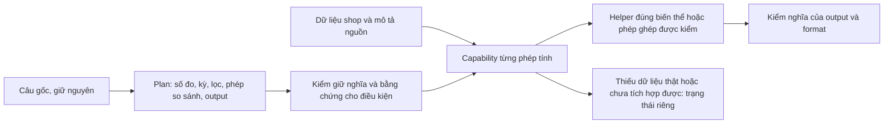

# DataMate: phương án tiếp cận và lỗi thực tế của Gemma-4

Ngày: 09/11/2026. Phần review ban đầu dựa trên source nhánh `gemma4-vllm-submission` và artifact Gemma-4 đã lưu; được lập bằng hậu kiểm, không gọi model hoặc chạy lại code FINAL. Các giải pháp dưới đây là đề xuất; theo dõi phép thử sau đó ở cập nhật bên dưới.

Cập nhật triển khai sau review: theo yêu cầu thử của người dùng, đã thêm chế độ opt-in `--question-mode normalize` và mở [EXP-20261109-01](../experiments/EXP-20261109-01-controlled-query-norm-public1000/manifest.json). Nội dung phân tích bên dưới mô tả baseline trước thay đổi; kết quả normalization được ghi riêng trong thư mục thực nghiệm. Biến thể giữ shape/count/needs nhưng thay phần viết lại tự do bằng edit proposals có kiểm, nên phép đo đánh giá cả hợp đồng preprocessing mới, không cô lập riêng tác dụng của edits.

Tài liệu nền: [08 — Overfit và khả năng nhận biz mới](08-phan-tich-overfit-va-biz-moi.md). Bộ bằng chứng từng câu: [cases.md](../artifacts/review-20261109-errors/cases.md), [summary.json](../artifacts/review-20261109-errors/summary.json), [script hậu kiểm](../artifacts/review-20261109-errors/audit.py).

## 1. Kết luận và phạm vi

**Có phương án tiếp cận cụ thể: giữ các phép tính nghiệp vụ, nhưng thêm hợp đồng về nghĩa câu hỏi và điều kiện của từng phép tính trước khi thực thi. Ưu tiên sửa sai nghĩa do rewrite và đường xử lý dữ liệu không đủ; chưa có căn cứ để chỉ thêm ví dụ hoặc đổi model.**

Điểm cần điều chỉnh so với review tổng quát trước: rủi ro schema vẫn quan trọng với biz mới, nhưng trên tập lỗi Gemma-4 đã lưu, có nguyên nhân sớm hơn và cụ thể hơn: **9 câu hỏi số đơn bị rewrite thành doanh thu, 2 câu khác bị rewrite sai phép tính/dạng đáp án**. Vì vậy cần bảo vệ nghĩa đầu vào trước khi đầu tư thêm tầng mapping tổng quát.

Phạm vi đối chiếu là submission Gemma-4 của `EXP-20261108-02-gemma4-public1000`, gồm 100 câu từ run ngày 08/11 lúc 11:02:02 và 900 câu từ run lúc 19:25:16. Dùng lại logic chấm local đã có, kết quả khớp RESULT:

| Cách chấm local | Điểm chuẩn hoá | Accuracy trên câu đã trả lời | Coverage | Đúng / sai / trống |
| --- | --- | --- | --- | --- |
| Lenient, có đối chiếu thêm tên/mã | +0,943 | 97,77% | 98,70% | 965 / 22 / 13 |
| Strict | +0,915 | 96,35% | 98,70% | 951 / 36 / 13 |

Điểm chuẩn hoá = `(đúng − sai) / 1000`. **Tham chiếu là Claude, không phải gold chính thức.** Tất cả số trong tài liệu là hậu kiểm artifact cũ; không phải điểm của một phương án mới. Scorer lenient dùng norm CSV hiện tại để đối chiếu alias; script lưu hash nguồn và cache alias để chỉ rõ phụ thuộc này.

## 2. Các lỗi đã xác nhận

### 2.1. Phân nhóm 22 câu sai theo lenient

Mỗi câu được xếp một nhóm chính để không đếm trùng. Nhóm tham chiếu đáng ngờ vẫn giữ verdict local ban đầu, không sửa gold để làm đẹp điểm.

| Nhóm chính | Số câu | Bằng chứng quan sát | Ý nghĩa đối với hướng sửa |
| --- | ---: | --- | --- |
| Rewrite đổi số đơn thành doanh thu | 9 | Rewrite được chấp nhận; FINAL gọi `revenue` | Lỗi hiểu nghĩa trước khi thực thi, không phải thiếu helper đếm đơn |
| Trả lời dù không chứng minh điều kiện/tiêu chí | 6 | Hỏi lý do, địa chỉ, tính cách nhưng code dùng thống kê khác | Cần kiểm đủ điều kiện của câu hỏi, không chỉ code chạy được |
| Ví dụ curated sai đơn vị | 1 | Hỏi `dia`, mẫu gọi `unit='ly'`, FINAL theo mẫu | Ví dụ phải đúng nghĩa, không chỉ có code hợp cú pháp |
| Rewrite đổi phép tính và số kết quả | 1 | Nhập trừ bán bị viết thành nhập từ đâu và bán bao nhiêu | Không để rewrite tự đặt thêm mục tiêu trả lời |
| Rewrite gán percent cho câu hỏi số phần | 1 | Code chia số lượng cho doanh thu để ra kiểu đã gợi ý | Type của phép tính phải khớp số đo thật, không tự biến đổi số để chiều shape |
| Dùng doanh thu để hỏi phí ship | 1 | `revenue(..., item='Phí ship')` trả 0 | Chọn đúng phép tính, vì phí ship bị loại khỏi doanh thu theo chủ đích |
| Công thức tỉ trọng sai | 1 | Tử và mẫu giống hệt nhau | Kiểm vai trò tử/mẫu và tập đối tượng của số đo |
| Tạo phụ thuộc dữ liệu không cần thiết | 1 | Câu đã cho ngày nhưng code đi tìm ngày từ bảng giá | Điều kiện khả dụng phải theo biến thể phép tính được chọn |
| Tham chiếu có dấu hiệu không phù hợp rulebook | 1 | Câu “trung thực nhất” có reference là tên khách | Cách ly bất đồng reference để kiểm lại, không học phép thay nghĩa vô căn cứ |
| **Tổng** | **22** | | |

Phân nhóm chi tiết nằm trong `cases.jsonl`; đây là nhãn thủ công dựa trên log và source, không phải kết quả một classifier tự đoán nguyên nhân.

### 2.2. Rewrite sai số đo: 9 câu có cùng dấu hiệu

Ví dụ [q_08f075b54698](../artifacts/review-20261109-errors/cases.md#q_08f075b54698):

- Gốc: “Từ đầu năm tới hết hnay tiệm có tổng cộng bnhiu đh rồi?”
- Rewrite đã được nhận: “Từ đầu năm tới hết hôm nay cửa hàng có tổng cộng bao nhiêu **doanh thu** rồi?”
- FINAL: `revenue(clock.year_to_date())`, ra `2433341500`; tham chiếu là `14783` đơn.

Tám câu còn lại cùng dấu hiệu là `q_0f7d15097a8c`, `q_2927db159ea7`, `q_3ef55d803554`, `q_66ee0467ce9e`, `q_856d8521b9ea`, `q_95a45f58351b`, `q_b3c75e9f2c97`, `q_c76ae61c6092`. Cả chín có `rewrite.problem = null`.

**Nguyên nhân đã xác nhận:** [check_rewrite](../src/datamate_agent/question_rewrite.py) dòng 91–117 kiểm số, kỳ, một số từ thời gian, đơn vị và tên; không kiểm bảo toàn số đo `orders` với `revenue`. `number` cũng không phân biệt tiền với số đơn. Trong khi đó [question_norm.py](../src/datamate_agent/question_norm.py) đã có luật `dh/ddh → don`: không phải toàn hệ thống không biết từ viết tắt này; bước LLM rewrite không được ràng buộc vào cách hiểu đúng đó.

Log chứng minh lỗi rewrite hiện diện trước khi agent chọn FINAL. **Chưa có đối chứng tắt/sửa rewrite**, nên không nói rằng bỏ rewrite sẽ cứu chắc cả chín câu hoặc làm tăng điểm toàn tập.

### 2.3. Rewrite tự đặt thêm mục tiêu và shape có thể điều khiển sai đáp án

[q_b4171cc74531](../artifacts/review-20261109-errors/cases.md#q_b4171cc74531) hỏi bánh croissant “nhập zìa trừ số bán ra”. Rewrite thành “nhập **từ đâu và** tổng cộng bán ra được bao nhiêu cái”, gán `list`, `count=2`. Mẫu đầu thực ra dùng đúng `purchase_minus_sold`; FINAL lại thêm `main_supplier`, trả `["Cty Đàm Phương", 23]` thay vì `23`.

[q_b4ad3b8d023f](../artifacts/review-20261109-errors/cases.md#q_b4ad3b8d023f) hỏi topping bán bao nhiêu **phần**, rewrite giữ nguyên câu nhưng gán `shape=percent`. Mẫu đầu dùng `quantity` đúng loại, nhưng FINAL chia `quantity / revenue`, làm tròn ra `0.0` percent thay vì tham chiếu `114` phần.

**Hai case này không thể giải thích chỉ bằng “ví dụ đầu sai”.** Shape và rewrite có thể mâu thuẫn với mẫu đúng. Thêm ví dụ chưa chắc xử lý được một chỉ dẫn phía trước đang đổi nghĩa câu hỏi.

### 2.4. Một ví dụ curated có lỗi rõ ngay trong nội dung

[library_curated.jsonl:89](../src/datamate_agent/prompts/library_curated.jsonl) ghi:

```text
question: bnhiu dia
code: quantity(clock.last_week(), unit='ly')
```

[q_1a35be96a5bd](../artifacts/review-20261109-errors/cases.md#q_1a35be96a5bd) hỏi “Tuan nay quan ban dc bnhiu dia?”, lấy chính ví dụ này lên đầu và gọi `quantity(clock.this_week(), unit='ly')`: ra `124`, tham chiếu `1581` đĩa.

Lỗi mẫu có hai mặt: `dia` không khớp `ly`, và câu mẫu không nêu kỳ nhưng code tự có `last_week`. Việc mẫu nằm trong curated không làm nó tự đúng. Cần kiểm nghĩa câu–code trước khi dùng làm chuẩn hướng dẫn.

### 2.5. Sáu câu bỏ hoặc thay điều kiện câu hỏi

| Case | Điều câu hỏi thực sự cần | Code cuối làm gì |
| --- | --- | --- |
| `q_20221903b95b` | Đơn huỷ **vì giao trễ** | Đếm mọi đơn huỷ bằng `cancelled_orders` |
| `q_35b891c4eebe` | Thợ **nhiệt tình nhất** | Chọn `busiest_staff` |
| `q_36182821dc30` | Khách ở **đường Mai Chí Thọ** | Lọc một khách tên “Lương Mai Linh” |
| `q_76bdadbeb802` | Khách **thân thiện nhất** | Xếp hạng theo doanh thu |
| `q_95aa9007198f` | Khách **khó tính nhất** | Xếp hạng theo số đơn huỷ |
| `q_e2e4e0639619` | Sản phẩm **ngon nhất** | Xếp hạng theo lượng bán |

Tham chiếu yêu cầu `unanswerable` ở cả sáu. Code/log xác nhận các phép tính không thể hiện tiêu chí gốc; không có căn cứ để đồng nhất những tiêu chí đó với doanh thu, lượng bán hoặc số đơn huỷ.

Case địa chỉ còn cho thấy lỗi ở cổng sửa tên: sau lỗi `no customer matches 'đường Mai Chi Tho'`, model nộp `unanswerable`; [_final_unanswerable](../src/datamate_agent/agent.py) dòng 384–387 yêu cầu chọn tên trong `closest are`. Model sau đó chọn “Lương Mai Linh” và trả tiền mua. **Fuzzy matching (gợi ý theo độ giống chuỗi) đang bị dùng như bằng chứng cùng nghĩa, trong khi hai chuỗi thuộc hai loại đối tượng khác nhau.**

Trường `needs` đã ghi lý do/địa chỉ/tính cách trong cache rewrite của các câu này, nhưng luồng agent hiện chỉ biến shape/count thành gợi ý trong `analysis_hint`; chưa đối chiếu từng need với khả năng dữ liệu. Dữ liệu `needs` sẵn có không có nghĩa có thể tin tuyệt đối: vẫn phải kiểm với câu gốc và thông tin nguồn.

### 2.6. Ba lỗi chọn/cấu tạo phép tính khác

1. [Phí ship — q_4497ce0830d8](../artifacts/review-20261109-errors/cases.md#q_4497ce0830d8): FINAL dùng `revenue(..., item='Phí ship')`, ra 0 thay vì tham chiếu 4.825.000. `_add_keys` cố ý loại dòng ship khỏi `is_revenue`; đã có [order_fee_total](../src/datamate/domains/baby.py) cho phép tính riêng. Không nên sửa `revenue` để bao gồm ship chỉ nhằm cứu câu này, vì sẽ đổi nghĩa số đo doanh thu.
2. [Tỉ trọng máy mới — q_4b82c6814a0d](../artifacts/review-20261109-errors/cases.md#q_4b82c6814a0d): FINAL lấy `(tiền máy mới + tiền máy cũ)` chia chính biểu thức đó, ra 100; tham chiếu 78,49. Đã có [new_machine_share](../src/datamate/domains/phone.py) dòng 71–75. Cần kiểm nghĩa tử/mẫu, không chỉ type percent.
3. [Hiệu ứng giá — q_f971c5fb2353](../artifacts/review-20261109-errors/cases.md#q_f971c5fb2353): câu nêu rõ ngày 29/05/2025, nhưng FINAL dùng `price=146000` thay vì truyền ngày. [price_effect](../src/datamate/shop.py) dòng 602–607 vì thế gọi `price_raise_date`, cần bảng giá không có; model nộp `unanswerable`. Dữ liệu thiếu ở đường thực thi đã chọn không chứng minh bài toán thiếu dữ liệu. Nhánh nhận ngày có sẵn không cần bảng giá. Chưa chạy lại nhánh đúng nên không khẳng định nó đã tái tạo ra 6,43 của tham chiếu.

## 3. Bỏ trống và giới hạn của đáp án tham chiếu

### 3.1. 13 câu trống đều kết thúc bằng vượt deadline, nhưng lỗi phía trước khác nhau

Script kiểm đủ 13 log có `reply exceeded 180s`. Theo tham chiếu, 9 câu là `unanswerable`, 4 câu có đáp án khác: 2 number, 2 string. Cần xử lý cả hành vi không kết thúc lẫn tình huống khiến model đi vào vòng sửa lỗi.

| Tình huống phía trước deadline | Số câu | Chi tiết |
| --- | ---: | --- |
| Tham chiếu không trả lời được | 9 | Thiếu kênh, nhóm, giới tính, địa chỉ hoặc lý do; có trường hợp helper đã báo thiếu đúng, có trường hợp model chọn sai phép tính |
| Tính ra số đúng nhưng khai sai type | 1 | `q_338d0179f66d`: helper in `6`, trùng reference; FINAL khai list nên bị từ chối rồi model vượt deadline |
| Sinh code không hợp lệ theo giao diện | 2 | `q_36edc7d2e347`: bỏ dấu nháy `staff/orders`; `q_3da612131082`: metric `commission` không thuộc `ranking`, dù đã có `commission_table` |
| Chưa sửa được alias tên món | 1 | `q_5971d8343cc7`: Cháo ngao; helper gợi ý Cháo nghêu trước khi model vượt deadline |
| **Tổng** | **13** | |

Ví dụ [q_7c6452fd1c4b](../artifacts/review-20261109-errors/cases.md#q_7c6452fd1c4b) hỏi khách ở một đường không được shop ghi: model đã chọn `unanswerable`, cổng bắt thử hàm vì chưa chạy code, lần gọi kế tiếp không dừng. Đây là bằng chứng cổng bắt buộc thử code có thể thêm một bước vô ích cho câu thiếu dữ liệu; không chứng minh bỏ cổng cho mọi câu sẽ tốt hơn.

Source [llm_client](../src/datamate_agent/agent.py) dòng 128–150 có deadline nhưng lời gọi chưa khai giới hạn token sinh. Đề xuất kiểm soát output/token và điều kiện kết thúc lệnh cần được đo; chỉ tăng timeout sẽ chưa xử lý gốc. Không tự lấy output dở dang làm đáp án đã xác thực.

### 3.2. 14 bất đồng strict/lenient và hai cảnh báo về nghĩa reference

14 câu được lenient nhận nhưng strict không nhận chủ yếu khác biểu diễn tên/mã hoặc cách ghi tên kèm số điện thoại. Chúng được lưu riêng, không cộng vào 22 lỗi thuật toán; từng alias vẫn cần kiểm đúng định danh trước khi coi verdict lenient là chuẩn chính thức.

Hai case cần kiểm lại độc lập:

- `q_6e929cf36203`: “khách trung thực nhất” có reference là một tên khách; rulebook không định nghĩa trung thực bằng một thống kê. Model chọn khách có nhiều đơn huỷ cũng không có căn cứ. Không học một phép thay nghĩa chỉ để khớp reference này.
- `q_611bf24dd2f9`: “nhà cung cấp uy tín” được reference trả tên công ty; model gọi `main_supplier`, là thống kê nhiều phiếu nhập nhất. Scorer lenient chấm đúng tên/mã, nhưng đúng đối tượng theo tham chiếu chưa chứng minh đúng nghĩa “uy tín”. Case này nằm trong 14 bất đồng biểu diễn, đồng thời có cảnh báo nghĩa.

Không sửa reference gốc hoặc loại case ra khỏi điểm đã báo. Hai cảnh báo cũng cho thấy **không thể suy toàn bộ 965 câu lenient đúng đều đúng nghiệp vụ** chỉ từ sự đồng ý với Claude.

## 4. Phương án tiếp cận đề xuất

### 4.1. Tạo một biểu diễn phép tính có kiểm trước khi gọi helper

Tôi ưu tiên pattern **Interpreter với Intermediate Representation (biểu diễn trung gian của yêu cầu tính toán)**: model diễn giải câu hỏi thành một plan có cấu trúc; code kiểm plan và thực thi các phép tính đã có. Nó tận dụng Semantic Layer (lớp số đo nghiệp vụ dùng chung), đồng thời giảm việc model vừa diễn giải vừa tuỳ ý ghép công thức. Đây là hướng thiết kế để duyệt, chưa phải cải tiến đã đo.



Ví dụ tối thiểu cho câu số đơn: số đo = `orders`, phép tính = đếm mã đơn khác nhau, kỳ = từ đầu năm tới ngày câu hỏi, output = một số có đơn vị `order`. `revenue` trả tiền không phù hợp dù cả hai cùng JSON type `number`.

Plan cần biểu diễn được:

- Số đo và đơn vị: tiền, đơn, lượng hàng, ngày, khách; không chỉ `number`.
- Phép tính: cộng, đếm, xếp hạng, chênh lệch, tỉ trọng; tỉ trọng phải có phạm vi tử và mẫu riêng.
- Kỳ, tên và mọi điều kiện lọc; mỗi điều kiện có phần văn bản gốc làm bằng chứng.
- Thông tin câu hỏi đã cung cấp, như ngày đổi giá; không đi tra lại một dữ kiện đã có một cách không cần thiết.
- Dạng đáp án và thứ tự phần tử, suy từ yêu cầu thực thay vì dùng shape để ép biến đổi phép tính.

Không cần mở một tập intent cố định cho mọi câu rồi từ chối câu lạ. Dùng các phép tính có thể ghép và chỉ kết luận hỗ trợ khi có đủ contract. Pydantic kiểm được cấu trúc plan, nhưng **không tự chứng minh model hiểu đúng nghĩa**; vẫn cần kiểm những mâu thuẫn phát hiện được từ câu gốc và đo lỗi còn lại.

### 4.2. Capability theo phép tính và nguồn dữ liệu, không chỉ theo nhãn ngành

**Capability** là điều kiện để một phép tính thực hiện được trên shop. Mỗi phép tính cần khai rõ bảng/cột, quan hệ, đơn vị và chính sách nghiệp vụ mà nó dùng; có thể có nhiều phương án thực hiện.

Ví dụ `price_effect` có ngày do câu hỏi cung cấp chỉ cần lượng bán hai kỳ; biến thể chỉ có mức giá mới mới cần bảng lịch sử giá. `revenue` và `order_fee_total` đều cộng tiền nhưng dùng hai tập dòng có nghĩa khác nhau. Phát hiện đủ bộ lọc theo địa chỉ đòi dữ liệu địa chỉ, không thể thay bằng tìm một tên khách gần chuỗi.

Đầu ra kiểm capability cần phân biệt: có thể tính; dữ liệu thật sự không ghi thông tin; thông tin có nhưng mapping/quan hệ chưa được hệ thống hiểu; lỗi thực thi. Không tự đổi ba trạng thái sau thành cùng một `unanswerable` hoặc cùng một số 0.

### 4.3. Tích hợp biz mới bằng hợp đồng nguồn, mở rộng domain khi có nghĩa mới

**Adapter** là phần chuyển cấu trúc nguồn sang hợp đồng dữ liệu chung. Tận dụng mapper hiện có, nhưng cần kiểm được bảng nguồn nào đóng vai trò nào, cách nối, phạm vi ID, đơn vị và khoảng bao phủ. Đừng chỉ nhận tên cột rồi coi Semantic Layer đã đủ đầu vào.

- Biz mới nhưng cùng ý nghĩa đơn/dòng hàng và cùng luật: có thể dùng các phép tính đang có sau khi map và kiểm đủ dữ liệu. Không cần một nhánh theo `business_id`.
- Schema mới nhưng nghiệp vụ cũ: cần bổ sung cách tích hợp nguồn; LLM có thể đề xuất mapping khi luật tất định không đủ, nhưng phải qua kiểm quan hệ và đối chứng số đo, không chỉ parse type.
- Nghiệp vụ mới như số dư buổi học hoặc thuê theo giờ: cần định nghĩa phép tính và điều kiện dữ liệu mới. Không thể chỉ đổi tên cột để `revenue` mang đúng mọi nghĩa mới.

**Đánh đổi:** thêm hợp đồng và kiểm trước sẽ tăng công chuẩn bị/định nghĩa, đổi lại có khả năng phát hiện không hỗ trợ thay vì tính sai im lặng. Chưa có số đo chứng minh hình thức plan hay adapter cụ thể nào tốt nhất. Chưa cần quyết định thay mixin, thêm framework plugin hoặc đổi toàn bộ cấu trúc source.

### 4.4. Giữ đường thử code, nhưng có giới hạn và trạng thái rõ

Pandas/Python vẫn hữu ích cho phép ghép chưa có helper. Tuy nhiên cần kiểm nghĩa plan trước khi chạy, giới hạn generation và giữ bằng chứng cột/bảng/phép lọc đã dùng. Một error `no matches` chỉ là gợi ý tìm ứng viên cùng loại; chưa phải quyền thay một điều kiện bằng đối tượng gần chuỗi bất kỳ.

Nếu không đủ cơ sở trả lời, lựa chọn phải phân biệt thiếu dữ liệu thật với lỗi hiểu/tích hợp. Với điểm +1/−1/0, abstain có thể tránh một đáp án sai, nhưng không dùng nó để che lỗi hoặc làm mất các câu vốn tính được.

## 5. Thứ tự xử lý và cách kiểm chứng

| Thứ tự | Việc đề xuất | Bằng chứng liên quan | Cách kiểm trước khi chốt |
| --- | --- | --- | --- |
| 1 | Kiểm và sửa mẫu curated sai nghĩa; tách khỏi thay đổi rewrite | Mẫu `dia → ly` đã đi vào một FINAL sai | Kiểm câu–code–đơn vị/kỳ của thư viện; đo cả câu được và câu mất sau đúng một thay đổi |
| 2 | Bảo vệ số đo/phép tính trong rewrite, giữ câu gốc là nguồn quyết định | 9 đổi đơn thành tiền; 2 sai nghĩa/shape; một blank đã có số đúng nhưng type sai | So cặp cùng câu, model và cấu hình giữa baseline với bản kiểm rewrite; theo dõi điểm/accuracy/coverage và lỗi đổi số đo |
| 3 | Kiểm điều kiện/capability; bỏ việc ép chọn closest như bằng chứng cùng nghĩa | 6 câu bỏ/thay điều kiện; một câu tạo phụ thuộc bảng giá; 9 blank có reference unanswerable | Kiểm riêng thiếu dữ liệu, thiếu mapping, tên gần khác loại; không chặn các alias thật hoặc ghép helper hợp lệ |
| 4 | Giới hạn sinh và sửa lỗi có đích | 13 deadline; trong đó có code đã tính được đúng giá trị | Đo token/thời gian, tỷ lệ lặp, lỗi type và coverage; không cộng nhóm này với nhóm rewrite/capability như các lợi ích độc lập |
| 5 | Thử plan và adapter trên dữ liệu giữ lại toàn nguồn/schema | Rủi ro biz mới trong tài liệu 08, chưa được đo bởi 22 lỗi public này | Giữ lại shop/họ schema; ghi độ đúng mapping/quan hệ, điểm, accuracy, coverage và chi phí xử lý |

Từng hàng là hướng xử lý, không phải một gói đổi nhiều thứ trong một lần đo. Không dự báo “sửa xong sẽ lên bao nhiêu điểm”: các nhóm nguyên nhân giao nhau, và thay đổi có thể làm sai các câu hiện đang đúng.

Để hạn chế overfit khi sửa: dùng lỗi đã biết làm case phát hiện lỗi, nhưng đánh giá trên câu/nguồn không dùng để viết bản sửa; thêm biến thể đổi số, kỳ, tên và cách chia bảng mà giữ hoặc tính lại gold đúng quy tắc. Tập đã đọc không trở lại thành tập độc lập chỉ bằng cách đổi tên. Các lần inference/thử thuật toán tiếp theo phải theo protocol thực nghiệm của repo; task này chỉ hậu kiểm log đã có.

Chưa đề xuất tắt toàn bộ rewrite: việc 11 câu sai có rewrite hỏng không cho biết số câu đúng đang được bước đó giúp. Cũng chưa đề xuất đổi model hoặc làm helper phụ thuộc mã shop; chưa có bằng chứng các cách đó xử lý đúng gốc các lỗi đã quan sát.

## 6. Danh sách từng câu và cách tái tạo

1. Đọc [cases.md](../artifacts/review-20261109-errors/cases.md) để xem đủ 22 câu sai, 13 câu trống và 14 câu chỉ bất đồng cách chấm. Mỗi case có câu gốc, rewrite, code cuối, output/tham chiếu và link log gốc.
2. [summary.json](../artifacts/review-20261109-errors/summary.json) chứa ba số điểm/accuracy/coverage, số đếm nhóm và hash đầu vào. [all_scores.jsonl](../artifacts/review-20261109-errors/all_scores.jsonl) lưu verdict của toàn bộ 1.000 câu.
3. [audit.py](../artifacts/review-20261109-errors/audit.py) chỉ chạy logic đối chiếu artifact và trích log; không thực thi code do model sinh. [README hậu kiểm](../artifacts/review-20261109-errors/README.md) ghi phụ thuộc và giới hạn tái tạo. Bộ chi tiết nằm dưới `artifacts/`, vốn bị gitignore; tài liệu này nằm trong `docs/`.

Lệnh từ gốc repo:

```bash
PYTHONPATH=src python3 artifacts/review-20261109-errors/audit.py > artifacts/review-20261109-errors/audit.log
```

Không chạy các script chấm cũ trực tiếp vì chúng có thể ghi lại vào thư mục thực nghiệm đã đóng. Script hậu kiểm ghi kết quả vào thư mục riêng; nguồn tham chiếu và các run cũ giữ nguyên.
