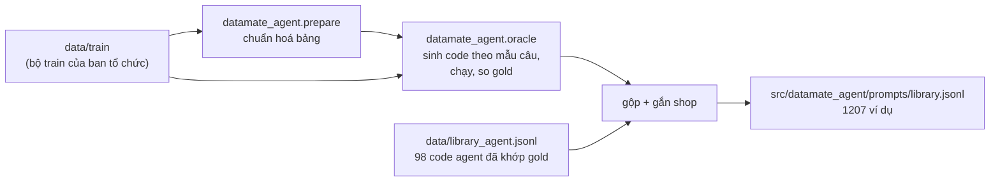

# training_code

**Không huấn luyện hay fine-tune model nào.** Model khi chạy là `google/gemma-4-12B-it` nguyên bản, revision
`707f0a3b8a3c7ad586ed01e27eafbad8a27dd0f7`. Dữ liệu duy nhất được sinh ra là thư viện ví dụ few-shot
`src/datamate_agent/prompts/library.jsonl`. Thư mục này chứa code, dữ liệu và log để dựng lại thư viện đó.



## Bố cục

```
training_code/
├── README.md
├── requirements.txt               # cùng phiên bản với /code/requirements.txt
├── train.sh                       # dựng lại thư viện ví dụ và so SHA-256 với bản đang dùng
├── download_model.sh              # tải weights đúng revision, kiểm SHA-256
├── stage_data.sh                  # chép bộ train vào data/train, ghi data_manifest.json
├── data_generation/
│   ├── build_library.py           # prepare → oracle → gộp ví dụ agent → gắn shop
│   └── make_manifest.py           # đường dẫn, kích thước, SHA-256 của dữ liệu, thư viện, weights
├── data/
│   ├── train/                     # bộ train được cấp, nguyên trạng (questions, answers, data/, split/)
│   ├── library_agent.jsonl        # 98 ví dụ do agent viết, khớp gold trên câu train
│   └── agent_example_logs/        # prompt và response gốc của từng ví dụ agent, index.jsonl nối ví dụ với log
├── logs/
└── data_manifest.json
```

## Dữ liệu

| Dữ liệu | Số mẫu | Ghi chú |
|---|---|---|
| `data/train/questions.jsonl`, `answers.jsonl` | 3000 câu | Bộ train của ban tổ chức |
| `data/train/split/train_*` | 2550 câu | Dùng để dựng thư viện ví dụ |
| `data/train/split/test_*` | 450 câu | Chỉ dùng để đo, không đưa vào thư viện |
| `data/library_agent.jsonl` | 98 ví dụ | Code FINAL của agent (gemma-3-12b-it qua OpenRouter, `temperature=0`, `seed=20261103`) trên câu `train_*`, giữ khi khớp gold |
| `data/agent_example_logs/` | 98 log | Prompt hệ thống, câu hỏi, mọi lượt trả lời và kết quả chạy code của đúng lần chạy sinh ra ví dụ |

Thư viện ví dụ:

1. `oracle` nhận dạng mẫu câu bằng luật (`datamate_agent/intents.py`), sinh code helper tương ứng và chạy trên bảng chuẩn
   hoá, trên cả 3000 câu theo thứ tự của `questions.jsonl`. Chỉ giữ câu thuộc `split/train_questions.jsonl` có kết quả
   khớp gold; trùng (câu đã che tên, loại câu) thì giữ câu gặp trước: 1109 ví dụ, 55 loại câu.
2. Thêm 98 ví dụ agent. Loại câu của chúng gán theo khung code: trùng khung với một loại oracle thì dùng chung loại đó
   (67 ví dụ), còn lại đặt loại `agent:<khung code>` (31 ví dụ). File giữ nguyên như khi dựng thư viện.
3. Mỗi ví dụ gắn danh sách shop có câu đó (`shops`), lấy từ `data/train/questions.jsonl`.

`library_curated.jsonl` (109 ví dụ) viết tay, không sinh bằng script.

## Lệnh

Tải weights và chép dữ liệu trước khi build image:

```bash
bash training_code/download_model.sh
bash training_code/stage_data.sh <thư mục train>
```

Dựng lại thư viện ví dụ và so với bản đang dùng (không cần GPU, không gọi model):

```bash
bash /code/training_code/train.sh /tmp/datamate_library_build
```

Lệnh báo `matches` khi thư viện dựng lại trùng SHA-256 với `src/datamate_agent/prompts/library.jsonl`.

| Thông tin | Giá trị |
|---|---|
| Phần cứng đã chạy | CPU, 5 tiến trình song song cho oracle |
| Thời gian | Chuẩn hoá 30 shop train và oracle 2550 câu: khoảng 10 phút |
| Bước không tất định | Không có trong `train.sh`. 98 ví dụ agent là đầu ra của LLM, nên giữ nguyên file và log gốc thay cho việc sinh lại |
